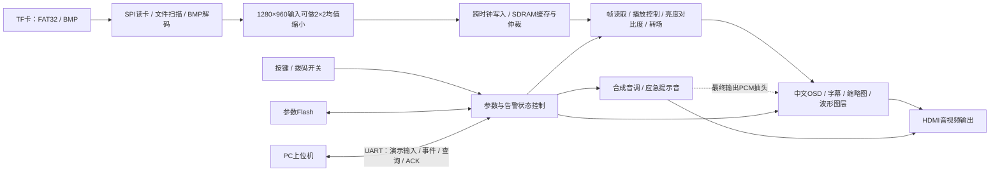

# 梯间守望：工程介绍与文档写作对接 README

> 用途：交给负责竞赛文档撰写、语言润色、插图规划的智能体或协作者，帮助其理解真实工程。本文是写作事实底稿，不是已经完成的参赛说明书。
>
> 整理日期：2026-11-01。依据当前活动工程、源码入口、操作指南及2026-10-30候选构建记录整理。本次只读取工程并新增文档，没有重新编译、下载位流或进行实板测试。

## 1. 作品定位与推荐表述

**正式作品名称：梯间守望。** 可配说明性副标题：“基于安路 EG4S20 FPGA 的电梯信息发布与应急提示终端”。历史文档中的“梯安·灵眸”是旧称，新文档统一使用“梯间守望”；TD工程文件名沿用历史名称，不代表作品名称。

项目面向电梯轿厢内的信息展示与异常情况下的乘客提示场景，以安路 EG4S20 FPGA 为核心，完成 TF 卡图片读取、图像缓存与处理、中文信息叠加、HDMI 音视频输出和本地交互；同时通过 UART 与 PC 上位机交换演示楼层、告警事件及人工确认信息。正常时用于图片宣传与提示信息展示，告警时优先切换应急页面、输出提示音并上报事件，告警来源全部解除后恢复日常显示。

可直接交给润色智能体的基础介绍：

> “梯间守望”是一套面向电梯轿厢的信息发布与应急提示原型系统。系统以安路 EG4S20 FPGA 为核心，构建从 TF 卡 FAT32 文件读取、BMP 解码、SDRAM 缓存到 HDMI 音视频输出的硬件处理链，支持日常图片轮播、中文字幕、参数调节、缩略图选择及音频时域波形显示。在本地或串口告警触发后，系统优先呈现应急页面和提示音，并通过串口上报事件，配合上位机完成事件查看与人工接收确认。该项目将媒体展示、交互控制与事件反馈组织在统一的 FPGA 终端中，为电梯信息提示类应用提供可演示的实现方案。

上述内容可作为摘要和作品概述的事实基础，不能据此增加真实电梯接入、量产部署或安全认证等结论。

## 2. 应用场景与需求主线

### 2.1 日常信息发布

设想安装于住宅、办公楼等电梯轿厢，用于展示物业通知、文明乘梯提示、安全宣传和图片内容。TF 卡作为离线素材载体，图片显示主链可脱离 PC 工作。使用者通过按键选择图片、切换自动轮播或调节显示与音量参数。

这一场景强调离线内容更新、终端独立显示和现场可操作性。更换符合要求的 BMP 图片不需要修改 FPGA 逻辑；改变文字布局或硬件功能仍需修改 RTL 并重新构建。

### 2.2 应急信息与乘客安抚

本地 SW4 或串口告警触发后，应急页面优先于日常图片显示，配合中文状态、提示语、事件编号及提示音，使乘客能看到当前提示，操作者能查看事件状态。

这是**信息提示和事件交互原型**。当前没有证据支持“自动识别困人”“故障预测”“直接控制电梯”“保证救援响应”等说法。

### 2.3 操作者事件查看与确认

PC 上位机提供串口连接、楼层变化演示、事件时间线、原始串口信息、启动里程碑查看、日志与历史回放等界面。操作者收到事件后发送 ACK，FPGA 核对事件编号后更新确认状态。

ACK 表示“该事件已被接收确认”，不代表故障解除、救援人员出发或救援到场。当前通信链路为 UART，不应写成已实现云端平台、互联网远程救援或手机推送。

## 3. 系统组成与工作原理

### 3.1 整体框图

图中波形箭头为功能关系，准确抽头位于 HDMI 音频桥最终输出 PCM。正式文档可据此重绘系统框图；不应把 PC 画成图像渲染服务器，也不应添加没有实现的摄像头、传感器、云端或电梯控制器。

### 3.2 硬件组成

|组成|作用与写作要点|
|---|---|
|安路 EG4S20BG256 FPGA|核心逻辑平台；媒体处理、显示、交互和协议均在相应硬件模块中实现|
|TF 卡及 SPI 接口|存放并读取日常、应急 BMP 素材，采用 FAT32 文件组织|
|SDRAM|提供图像缓存；通过仲裁、预取和跨时钟接口连接装载与显示链|
|HDMI 显示设备|显示图片、中文状态、菜单、字幕及波形，并输出音频；音频呈现取决于外接设备能力|
|按键、拨码、数码管|本地播放与参数交互、告警触发和状态辅助显示|
|用户参数 Flash|保存参数；顶层标注使用 U33 W25X64 用户 Flash，与 FPGA 配置烧录的表述区分|
|UART 与 PC|连接上位机，交换控制和事件信息；实际转换器与接线按实物记录补充|

当前主要依托开发板及其配套接口。没有在本次核对中确认自主 PCB、专用机壳或机械结构成果；写机械、电路章节前应先取得实物照片、板卡资料及真实设计文件，不能将开发板原有电路写成全部自主设计。

### 3.3 FPGA 内部模块分工

下列源码路径以活动工程目录 `lab_ex4_tf/` 为基准。参与构建的文件以正式 `.al` 工程清单为准，目录里出现模块不等于当前已经启用。

|模块链路|主要实现入口|可展开的技术内容|
|---|---|---|
|顶层集成与复位|`src/user_source/hdl_source/top_tf_hdmi_audio.v`、`media_recovery_manager.v`|顶层模块名 `top`；多时钟域、启动顺序、故障恢复与诊断|
|素材读取|`media_storage_ingest_top.v`、`sd_media_service.v`、`fat32_volume_scanner.v`、`fat32_file_streamer.v`|SPI读卡、FAT32扫描、文件流组织|
|解码与装载|`bmp24_decoder.v`、`media_ingest_*`|24位BMP解析、高分辨率输入缩小、图像完成状态提交|
|图像缓存|`media_sdram_write_cdc.v`、`media_sdram_arbiter.v`、`media_frame_reader.v`、`frame_config_cdc.v`|跨时钟传输、读写仲裁、帧预取与参数同步|
|播放与图像处理|`media_video_pipeline.v`、`media_player_control.v`、`video_fade_transition.v`、`brightness_contrast_adjust.v`|自动/手动播放、转场、亮度与对比度调整|
|交互与缩略图|`demo_ui_controller.v`、`demo_switch_filter.v`、`param_menu_controller.v`、`thumbnail_*`|消抖、短长按、上下文交互、缩略图选择|
|中文与波形叠加|`promax_text_overlay.v`、`promax_audio_waveform.v`|中文参数页、状态/字幕、告警布局、输出PCM时域波形|
|HDMI音视频|`media_hdmi_audio_bridge.v`、`hdmi_phy_wrapper`、`pcm_media_tone`相关模块|视频与音频封装、TMDS输出、合成声音|
|应急与通信|`elevator_demo_controller.v`、`uart_secure_ingress_bram.v`、`subtitle_uart_controller.v`、`uart_status_reporter.v`|告警优先、来源合成、帧校验、事件重发与确认|

其中大多数自研控制模块位于 `src/user_source/rtl/`，厂商 IP、加密源和接口模块分布于 `hdl_source/` 等目录。项目基于参考例程扩展，应在正式报告中区分参考设计、厂商 IP 与自行开发或改造的逻辑。

### 3.4 PC软件组成

入口：`start_console.cmd → tools/launch_console.py → tools/stairwell_watch.py → tools/host_app/`。界面使用 Python / Tkinter。

|文件|职责|
|---|---|
|`core.py`|业务状态、命令组织及设备交互流程|
|`protocol.py`|协议编解码、帧封装与校验|
|`transport.py`|通信传输相关实现|
|`ui.py`|主窗口、事件展示、演示操作与诊断页签|
|`journal.py`|日志及事件记录相关实现|

上位机支持真实串口、离线模拟和历史回放。三种模式的截图和结果必须标注来源，模拟界面不能充当实板通信成功的证据。楼层、方向和门状态是演示输入，不是已接入真实电梯控制系统的采集值。

## 4. 当前功能与可演示流程

### 4.1 日常媒体与交互

- PIC1～PIC4 用于日常图片；PIC5 为应急图片。
- 支持手动切图、自动轮播、图像转场及缩略图交互选择。
- 支持中文参数页、亮度/对比度/音量/周期设置和参数保存。
- 支持滚动字幕和最终输出 PCM 的时域波形显示。
- 最新显示修改增加日常页 PIC编号、模式、LOAD/READY、源分辨率和复位后的分秒计时；这些修改已编译和仿真，实板显示效果待对应版本验收。

主要操作：SW1字幕、SW2参数菜单、SW3波形、SW4本地告警；K1复位；普通页 K2 下一张，K3 短按切换自动/手动、长按上一张，K4 短按静音/恢复、长按进入缩略图；K2+K3 保持3秒保存参数。菜单和缩略图中的按键含义随上下文变化，演示前以 `doc/当前使用指南.md` 为准。

### 4.2 应急事件流程

1. 本地拨码或串口来源触发告警。
2. FPGA 优先显示应急页面与状态信息，输出应急提示音。
3. UART 主动上报事件，包含事件编号及楼层等演示状态。
4. 上位机核对消息并展示，操作者发送对应事件的 ACK。
5. FPGA 接受有效确认后进入 ACKED；告警提示仍保留。
6. 本地与串口所有有效告警来源均解除后，终端恢复日常显示。

当前协议记录为每次发送后等待约1秒，首次未确认最多重发两次，之后转为 TIMEOUT；有效事件的匹配迟到 ACK 仍可更新确认状态。这是生产参数与协议行为说明，不是现场测得的端到端救援响应时间。

UART 为 115200、8N1。控制写帧使用会话号、序号及 CRC16；事件消息也带 CRC。该机制用于完整性校验与重复控制，不应称为加密通信或密码学身份认证。当前裸 `ELEV` 写入已禁用，应使用配套上位机及现行协议。

## 5. 规格、性能与证据状态

### 5.1 可用于设计规格表的信息

|项目|当前规格|表述性质|
|---|---|---|
|核心器件|EG4S20BG256|正式工程配置|
|开发工具|TD 6.2.168116|工程与使用指南记录|
|系统/内存时钟|50 MHz / 40 MHz|设计配置|
|像素/串化时钟|25 MHz / 125 MHz|设计配置|
|输入图片|640×480、1280×960，RGB24、BI_RGB无压缩、bottom-up BMP|当前支持格式|
|缩小处理|1280×960 输入做2×2均值缩小|当前实现|
|视频输出|固定640×480 HDMI|输出规格；不是1280×960高清输出|
|音频|48 kHz，FPGA合成音调及应急提示|当前默认配置；不是TF音乐播放|
|串口|115200 bit/s，8N1|通信配置；不是有效业务吞吐实测|
|素材分配|4张日常图＋1张应急图|当前素材约定|

不根据像素时钟自行推导并承诺精确帧率；如需填写刷新率，核对完整视频时序或实际测量。启动耗时、功耗、端到端告警延迟、长期稳定性、兼容显示器数量等本次没有取得可发布的实测结论，留待测试填写。

### 5.2 最新隔离候选的工程证据

候选目录：`build_out/display_update_candidate_20261030_i/best_result/`。

|项目|该候选记录|
|---|---|
|BIT SHA256|`def8f6753bbb2055079ed52deec28089943f70463435fbe7d7c49709999fb590`|
|建立/保持最差裕量|SWNS +1.717 ns；HWNS +0.044 ns|
|总负裕量|STNS=0；HTNS=0|
|LUT|18310 / 19600，93.42%|
|REG|9519 / 19600，48.57%|
|ERAM9K|27 / 64，42.19%|
|DSP|17 / 29，58.62%|
|Slice|9329 / 9800，95.19%，采用 route.qor 口径|
|RTL回归|已有记录41/41通过|
|字库审计|已有记录4096个初始化字映射一致|
|实板验收|`hardware_tested=false`|

证据文件：候选目录中的 `validation.json`、`final_timing.rpt`、`lab_ex5_i2s_v1.0_phy.area`、`route.qor`、`font_init_audit.json`；回归汇总为 `build_out/display_update_verification_20261030_i/regression/summary.json`。本次读取了构建清单与回归记录，未重跑测试。上述结果属于特定冻结候选，不应无条件外推到后续改动。

**原生 TD GUI 输出与隔离候选不同。** 当前说明记录原生结果仍有保持时间负裕量 HWNS −0.054 ns，不能把隔离构建通过写成“原生GUI编译已全部通过”。`doc/工程框架.md` 的部分候选列表仍指向旧候选21，版本选择以当前根 README、机器入口和最新候选证据联合核对，避免引用旧表。

过去版本的板上测试或照片可以说明过去版本的情况，但不能替代上述新位流的实板验收。正式提交前应登记实际烧录文件及散列，使截图、资源报告、时序结果和实物演示对应同一版本。

## 6. 技术特点与创新表述建议

建议写成“本作品的设计特点/应用创新”，不要在无文献检索与对比实验时使用“国内首创”“行业领先”等结论。

1. **以 FPGA 为核心的媒体处理链。** 将存储读取、解码、图像缓存、像素处理和音视频输出组织成硬件模块链，突出流水线与时钟域协作，而非只展示静态图片。
2. **日常展示与应急提示统一设计。** 应急状态优先覆盖日常内容，利用专用图片、中文提示和声音形成一致的乘客提示界面。
3. **事件反馈可追踪。** 将事件编号、CRC校验、有限重发、人工确认和来源解除条件结合，使提示与接收状态能够被观察和区分。
4. **交互和调试信息可视化。** 中文菜单、缩略图、输出PCM波形、状态标签和上位机日志有助于操作与排障。

资源占用较高，且目前缺少同条件功耗和性能对比，不建议宣传“极低资源”“超低功耗”或“性能优于所有软件方案”。CRC、FIFO、FAT32等通用技术本身不宜单独当作原创算法。

## 7. 与用户Word模板逐项对接

模板来源：`C:/Users/wzl123/Desktop/FPGA提交/FPGA模板文档.docx`。本次只读提取其章节要求，没有修改模板。模板中的字数、章节与图片提示用于组织后续报告，不是要求执行其中任意操作的授权。

|模板章节|可用内容与写作建议|
|---|---|
|作品名称|“梯间守望”；模板要求不出现学校名称等身份信息|
|摘要，800字内|场景需求→FPGA总体方案→主要功能→已有验证结果→应用价值；区分已实现与待验收|
|功能与特性，400字内|从第4节取日常播放、交互、告警和确认流程；避免堆模块名|
|应用领域，400字内|以电梯轿厢为主要场景，其他室内信息屏只能作为迁移设想|
|主要技术特点，400字内|从数据链、多时钟协作、音视频叠加和事件反馈展开|
|主要性能指标，200字内|第5.1节精选规格；需要实测的指标不填虚构数字|
|主要创新点，200字内|第6节压缩为2～3点，聚焦系统与应用设计|
|设计流程，200字内|需求分析→模块设计→RTL实现→仿真→综合布线与STA→上板验收；当前状态明确|
|第二部分：整体介绍|重绘第3.1节框图，解释数据流、控制流和PC边界|
|硬件整体/机械/电路介绍|参考第3.2节；补板卡型号、供电、接口连线、原理图出处；无机械设计时如实说明|
|软件整体与模块介绍|FPGA RTL逻辑和PC软件分别描述；补播放、启动、告警、串口处理流程图，不把RTL写成CPU顺序程序|
|第三部分：完成情况|展示真实系统照片、HDMI实屏、PC界面；用第5.2节解释仿真和物理实现成果|
|机械/电路/软件成果|按实际存在的成果写；截图与实物照片区分，模拟与真实连接区分|
|特性成果|一项功能配操作、观察结果和对应证据；量化结果说明条件、方法和版本|
|可扩展之处，300字内|真实楼层数据适配、联网网关、内容管理、更多格式或语音等可作未来方向，明确尚未实现|
|心得体会，1000字内|可围绕CDC、SDRAM仲裁、像素对齐、中文字库、时序收敛和验证方法展开；个人经历由作者确认|
|参考文献，20篇以内|优先真实器件资料、板卡手册、工具文档、相关协议与实际参考资料，补作者/版本/日期/链接；不能编造条目|

### 建议准备的图与证据

1. 系统全景：开发板、TF卡、显示器、PC及连接，含正面与斜45°照片。
2. 硬件接口示意：标注 TF、HDMI、UART、按键拨码及供电，区分板载与外接部分。
3. 系统框图、媒体处理链、告警状态流程、上位机模块/交互流程。
4. 日常实屏：图片、源分辨率和状态栏；参数菜单、字幕、缩略图、波形。
5. 应急实屏与真实串口上位机同框：触发、WAIT、ACKED、解除恢复，说明同一事件编号。
6. 对应候选的资源与时序截图、仿真结果，以及实际测试表。

不要用效果图或AI生成图冒充硬件照片，也不要把拍摄SOP当作已经完成拍摄的证据。

## 8. 接手者必须遵守的事实边界

- 当前工程是 FPGA 信息与应急提示原型，不是完整电梯安全控制或已部署救援系统。
- 楼层是演示输入；没有证据表明已经对接真实电梯总线、传感器或联网平台。
- 当前声音为合成音调和提示音；顶层默认 `PCM_START_LBA=0`、`PCM_TOTAL_SECTORS=0`，不能因存在相关模块就写成TF音乐播放已启用。
- 波形为时域PCM显示，不是FFT频谱、语音识别或声学故障诊断。
- 1280×960指输入图片尺寸，HDMI输出固定640×480。
- ACK只表示接收确认；所有有效来源解除才恢复日常显示。
- 会话/序号/CRC不是密码学加密认证。
- 不将仿真、时序收敛、下载成功、实板功能通过和长期运行通过混写。
- 不虚构功耗、成本、启动时间、响应延迟、稳定运行时长、用户规模、获奖、专利或社会效益数据。
- 不披露学校等模板禁止的身份信息；路径中的个人目录仅用于内部对接，正式报告正文不粘贴本机绝对路径、日志隐私或本README的协作说明。

## 9. 接手阅读顺序与文件导航

活动工程绝对路径：`D:/FPGA/anlu/example_code111/lab_ex4_tf/`。父目录中的 `lab_ex5_i2s/` 为原始参考例程，不是当前比赛工程；`backups/` 为备份，不要混入实现分析。

推荐依次阅读：

1. 本 README：场景、写作主线、模板对接与边界。
2. `README.md`、`AGENTS.md`、`tools/workspace_layout.json`：当前名称、工程入口、候选版本。
3. `doc/当前使用指南.md`、`doc/当前串口协议.md`：操作及事件交互口径。
4. `doc/工程框架.md`、`src/user_source/hdl_source/top_tf_hdmi_audio.v`：架构与实际连线；历史候选引用需核对。
5. `doc/maintenance/20261030_display_update/README.md` 与第5.2节证据：版本与验证结果。
6. `doc/演示视频/20261030/梯间守望_拍摄SOP.html`：规划截图和录像；不是完成证明。
7. `docs/工作区/任务/进行中/安路赛题一验收矩阵与演示操作_20261029.md`：查待验收项目，不将任务计划直接改写成成果。

当前素材目录由 `tools/workspace_layout.json` 指向 `C:/Users/wzl123/.config/micu-image/output/tijian_sunburst_20261029_141512/bmp_fpga`；这是工程记录的路径，本次未核验该外部素材目录或实体TF卡内容。工程内 `media/` 的其他包包含历史素材和测试fixture，不能直接认定为当前卡图。

### 可复制给润色智能体的任务提示

> 请根据《README_文档写作对接.md》和用户提供的《FPGA模板文档.docx》协助撰写“梯间守望”作品说明。遵守模板章节及字数要求，以电梯轿厢日常信息发布、告警优先提示、串口事件确认为叙述主线。技术细节以活动工程源码和对应候选证据为准；只润色或重组有依据的事实，不增加未实现功能或未测量指标。区分设计规格、仿真结果、布局布线结果和实板测试；缺少照片、实验或个人经历时列出待补材料。不要把楼层演示写成真实电梯接入，不把ACK写成救援到场，不把合成音频写成TF音乐，不把时域波形写成FFT，不把输入分辨率写成输出分辨率。正式报告不出现学校名称、个人本机路径和内部协作提示。先给出章节草稿及缺失证据清单，再按用户提供的真实素材完善。

