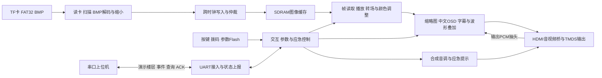

# 梯间守望当前工程框架

系统面向电梯信息发布与应急提示。FPGA完成媒体处理与显示输出，上位机通过UART发送演示楼层并接收事件。图像播放可脱离PC运行；断电自启以配置Flash烧录和现场验证为准。

## 正式入口

- 工程：src/td_project/lab_ex5_i2s_v1.0.al，top，EG4S20BG256。
- 顶层：src/user_source/hdl_source/top_tf_hdmi_audio.v。
- 上位机：start_console.cmd → tools/launch_console.py → tools/stairwell_watch.py → tools/host_app/。
- 构建：build_verified.cmd → tools/build_gui.py → setup_isolated_build.py → build_isolated.py，成功后输出独立best_result。

## 数据与控制流

图示表达功能关系，具体同步与抽头以生产顶层为准。波形来自音频桥最终输出PCM抽头，不是FFT或独立模拟动画。

## 模块责任

|链路|主要模块|源码目录|
|---|---|---|
|启动、复位、恢复|top、reset_sync、media_recovery_manager|hdl_source / rtl|
|读卡与装载|media_storage_ingest_top、sd_media_service、fat32_volume_scanner、fat32_file_streamer、bmp24_decoder、media_ingest_pipeline|rtl|
|SDRAM与CDC|media_sdram_write_cdc、media_sdram_arbiter、media_frame_reader、frame_config_cdc；厂商加密SDRAM控制器|rtl / hdl_source/include|
|播放与处理|media_video_pipeline、media_player_control、video_fade_transition、brightness_contrast_adjust|rtl|
|交互|demo_ui_controller、demo_switch_filter、param_menu_controller、thumbnail_controller|rtl|
|图层叠加|promax_text_overlay、thumbnail_layout、thumbnail_cache_builder、promax_audio_waveform|rtl|
|HDMI音视频|media_hdmi_audio_bridge、hdmi_phy_wrapper、pcm_media_tone相关模块|rtl / hdl_source|
|UART与应急|uart_secure_ingress_bram、subtitle_uart_controller、uart_status_reporter、elevator_demo_controller|rtl|
|上位机|core.py、protocol.py、ui.py、transport.py、journal.py|tools/host_app|

FPGA源码目录相对src/user_source；实际参与工程的文件以.al清单为准。历史副本与未登记模块不能因同名就视为已综合。

## 规格

|项目|当前设计|
|---|---|
|系统时钟|50MHz|
|SDRAM域|40MHz及其移相时钟|
|像素/串化时钟|25MHz / 125MHz|
|图片输入|RGB24无压缩BMP，640×480直接使用、1280×960做2×2平均缩小|
|输出|HDMI固定640×480、48kHz音频|
|UART|115200 8N1；会话/序号/CRC控制写帧，RESCUE带CRC；只读查询保留裸ASCII行|

## 状态边界

FPGA图片轮播与PC楼层演示是两套状态。告警可使上位机暂停楼层演示，解除后操作者点击继续；FPGA按自身状态恢复日常图像。SW3只控制波形显示；普通声音由静音/音量控制。菜单临时隐藏波形，保留SW3请求。

本地SW4和UART告警按有效来源合成。事件上报后可等待、超时或被人工确认；ACKED仍属告警有效期间，所有来源解除后才恢复。不把ACK写成自动解除或救援到场。

当前上位机连接后先建立会话，控制写入经安全接入模块验证后进入解析器。旧ELEV写入在生产顶层禁用，楼层使用独立FLOOR命令，不改写告警来源。线上封装和旧资料区别见[当前串口协议](当前串口协议.md)。

## 输出和证据

|目录|用途|
|---|---|
|src/|唯一活动源；不随整理搬动|
|build_out/final_repair_candidate_20261030_21|当前已完成隔离物理实现的候选，保留源副本；待实板|
|src/td_project/..._Runs|原生TD输出，BIT散列和hold结果与隔离候选不同|
|tests/results|测试输出；hardware_pass_20260928为历史实板证据|
|doc/演示视频/20261030|拍摄SOP和现场速查单|
|doc/maintenance|清理清单、保护散列、结构检查与恢复定位|
|docs/工作区|需求/设计/任务；旧目录名不替代实现检查|
|config/、logs/|偏好与真实运行日志|

版本、资源和时序看[根README](../README.md)；旧资料看[历史索引](历史资料索引.md)；操作看[使用指南](当前使用指南.md)，开发看[开发指南](开发指南.md)。
