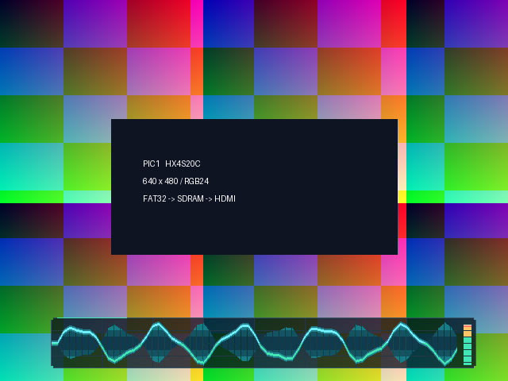

# 快速启动与音轨界面优化

2026-10-08 开始，2026-10-09 完成。本次落实读卡提速、首图提前显示两步优化，并改进底部音轨面板。当前 BIT 已通过软件仿真及完整布局布线，未进行本次实板下载或冷启动计时。

## 启动行为

原流程等四张 BMP 全部装载，再构建缩略图缓存，最后开放播放器。新版在每张图片的 BMP 解码、文件/FAT 尾链验证和写入排空全部完成后，将对应 bank 发布为可显示资源；首张有效图片立即进入显示，其余图片在后台依次加载。图片控制器只会选择已发布的 bank，缺失或损坏的 PIC1 不会被显示。图片加载结束后，缩略图页也在后台构建。

正常 SPI 的 `CLK_DIV` 由 4 改为 2，50 MHz 系统时钟下 SCLK 为 12.5 MHz；初始化仍为 DIV=64，即 390.625 kHz，上电等待仍为 5,000,000 拍，即 100 ms。

单张 640×480、RGB24 BMP 的大小为 921,654 字节。纯串行传输下限从 1.180 s 降到 0.590 s；新版首图只等待一张有效图片，而无需等完四张与缓存。目标是从约 5 s 缩短到约 1 s 量级，但字节间隙、FAT 访问、卡响应、FPGA 配置及显示器同步都会影响总时间，此处不把理论值当作实测值。坏图重试/跳过或 1280×960 输入会延长等待。

## 并发读写

新增 `media_sdram_arbiter.v`，每次授予完整的 128 字 SDRAM 事务。显示 FIFO 低于或等于半容量时优先供给显示；有足够缓冲时调度图片写入与缓存构建。读返回按当前所有者分发，避免缓存将显示数据误收。

写 CDC 在授予边沿呈现首字，后续 127 字连续发送。显示和缓存也只在首字等待授予；不能因为 busy/refresh 在突发中间变化就截断事务。仲裁器在 128 字全部返回或写命令全部提交后，等待控制器空闲并增加 16 拍排空时间，再切换所有者。图片发布另外要求跨域写空闲信号连续稳定 256 个系统时钟。

新增错误排空保护：若解码错误恰好发生在加载器已开始输出一个突发之后，会停止接收新像素、完成已经完整缓冲的当前突发，再报告加载失败。这样写 CDC 不会留下不足 128 字的半个事务，影响重试/跳过后的有效图片。失败图片始终不发布。

缩略图就绪信号同步到像素域后才响应 SW1。提前打开并保持 SW1，会在缓存完成后进入缩略图页。缓存出错不会关闭已经运行的原图播放。可选卡内 PCM 的 SD 所有权仍等后台工作完成后才移交，默认合成音调可先运行。

## 音轨面板

- 64 点双采样缓冲，48 kHz 输入每 8 个样本取一点，采集窗口约 10.7 ms；只在帧边界换显示缓冲，减少撕裂和抖动。
- 波形线在相邻采样之间用移位加法插值；加入青/绿色连线、柔光和对称渐变包络。
- 暗色半透明背景、细网格、虚线零轴和切角边框；右侧使用分段音量柱、快攻慢退及约 0.2 s 的峰值保持。
- 文字叠加与波形合成之间增加一拍流水线，RGB、HS、VS、DE、坐标和诊断图案一同延迟，保持 HDMI 视频与音频岛坐标一致。

以下是实际波形 RTL 在项目 PIC1 演示素材上的仿真渲染，使用合成测试样本；仅展示新增面板，不包含其他 OSD，非实板截图。

## 收益与取舍

| 项目 | 预期收益 | 难度及取舍 |
| --- | --- | --- |
| SD 正常读提速 | 单张纯传输时间下限减半；缩短加载阶段 | 低；需要实板检查不同卡在 12.5 MHz 下的信号与 CRC。若卡不稳定，将顶层 `.SPI_CLK_DIV(2)` 改回 4 后重新构建 |
| 首图显示与后台装载 | 黑屏等待从四张图片及缓存缩短为首张有效图片 | 中高；增加存储仲裁、返回分流与发布状态；缓存模式需等就绪 |
| 音轨面板 | 更平滑的曲线、振幅层次与持续可读的峰值反馈 | 中；增加采样缓冲和合成逻辑，有一帧内的采集/发布延迟，新增一拍像素延迟 |

本次整机资源与时序：

| 指标 | 2026-09-28 基线 | 本版 |
| --- | ---: | ---: |
| LUT | 14,395 / 19,600（73.44%） | 15,097 / 19,600（77.03%） |
| 寄存器 | 7,938 | 8,059 |
| BRAM9K | 15 / 64 | 15 / 64 |
| DSP | 17 / 29 | 17 / 29 |
| 最差建立/恢复裕量 | +0.018 ns | +0.547 ns |
| 最差保持裕量 | +0.004 ns | +0.021 ns |

LUT 增加 702，寄存器增加 121，BRAM/DSP 用量相同；时钟和约束未放宽。建立/保持均通过，但保持裕量仍较小。较快 SPI 的瞬时活动率与新面板逻辑可能增加运行功耗；加载更快可能减少启动能量，两者需要电流/能量实测，不能声称整机已降低某个百分比。

## 验证与交付

执行 `tools/run_tests.py`、`tools/run_vendor_tests.py`、`tools/run_fast_boot_tests.py` 和 `tools/build_gui.py`。

- 14 项既有模块回归与 4 项原厂模型回归通过。
- 首图在最终 done 前发布，只有写入完整且排空后才发布；非法 FAT 尾链的 PIC1 始终不发布。
- 在首图输出第 32 字时注入解码错误，重试同样失败后跳过；两次已开始的突发各输出完整 128 字，后续三张均正常发布。修复前该用例会卡在排空状态，修复后通过。
- 引脚协议模型检查慢速初始化/高速读取的高电平脉宽、512 字节数据顺序与 CRC 错误拒绝。
- 并发显示/写入/缓存回读通过，核对 SDRAM 模型中全部 1,152 个图片写入字与 128 个缓存返回字。
- 25 MHz、640×480 显示与真实缩略图构建并发时，核对 847,958 个显示像素、全部 307,200 个缓存写入字，经历 1,485 次刷新，无下溢。
- 波形测试检查双缓冲隔离、抽取、正负满幅限幅、静音、峰值保持/衰减、面板边界与禁用旁路，并输出逐像素预览。
- TD 6.2.168116 完整综合、布局、布线、STA 与 bitgen 通过。原厂 IP/FIFO 的已有告警保留在构建记录中。

固件：`src/td_project/lab_ex5_i2s_v1.0_Runs/best_result/lab_ex5_i2s_v1.0.bit`。SHA256：`bc22aaa90cd50123b87e76618e6858ff05761925df8ffdfd0a8f3307e2c65cfe`。构建与回归记录、时序和面积报告随固件放在 `best_result`。旧实板通过版本备份位于 `tests/results/before_fast_boot/best_result`，历史验收快照仍保留。

上板重点记录：供电到首图、复位释放到首图、全部图片可切换和 SW1 缓存就绪的时间；核对后台加载时无 E63/E86、音轨响应静音/音量、缺图/坏图跳过、多次冷启动及长时间播放。软件模型不包含真实卡的电气时序或显示器锁定时间。
