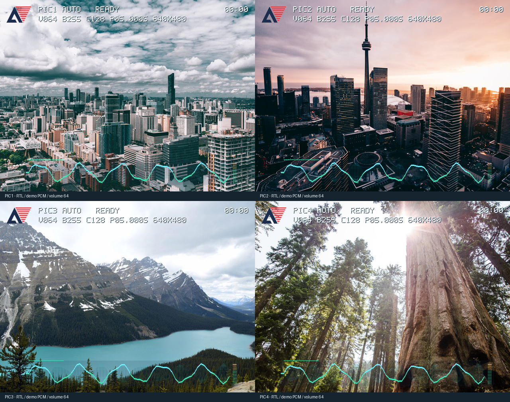
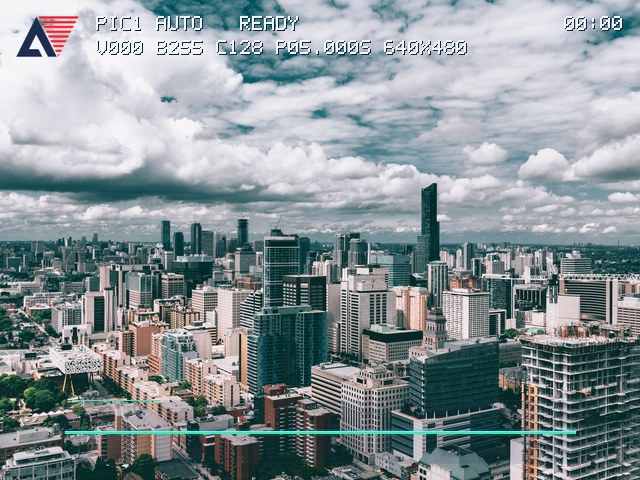

# 照片优先界面与启动静音

构建于 2026-10-09T01:16:44.517940+08:00，已生成当前下载入口的 BIT。38 项回归/专项检查通过，实板尚未烧录验收。

## 行为与素材

每次上电和 K1 复位音量为 0，首次短按 K4 升到 64。Flash 仍保存音量、周期和模式，运行中的调节/保存回读正常；启动仅忽略保存音量，继续恢复周期及自动模式。通用 player_config_persistence 的 RESTORE_VOLUME_ON_BOOT 默认 1，生产顶层设 0、DEFAULT_VOLUME 设 0，像素 CDC 和菜单复位值同步为 0。记录格式未变。

底部音轨保持原位置与 64 点双缓冲。底板/网格按 floor((7×原图+效果色)/8) 混合，包络/柔光按 floor((3×原图+效果色)/4) 混合，始终从原始照片像素计算，避免叠层累积变暗。细波形和峰值标记保持清晰。移位、加减法实现，不增加 DSP。静音采样到达后，在不写入显示 bank 的前提下用六帧移位衰减回零轴，约 101 ms；PCM 本身立即静音，峰值保持/回落沿用现有机制。

状态位于 (96,16)，包含 PIC 编号、MANUAL/AUTO、LOAD/READY，错误时显示 ERR xx Dxx。参数位于 (96,40)，V=音量、B=亮度、C=对比度、P=周期，示例 P12.345S 为 12345 ms，随后为实际源尺寸（640X480 或 1280X960）。计时位于 (564,16)，字号/间距统一。数字使用字段变化触发的 16 拍 double-dabble 转换，在帧边界提交，像素路径不做十进制除法。

字幕位置 y=72、每三帧滚动一像素。已取消整条实底，采用浅色字与一像素深色阴影。根据用户追加要求，删除工作室署名，上电/复位默认关闭且为空。仍可用 SUB=HELLO 加 SUB=ON 开启自定义字幕；SUB=CN 或 UTF-8 的 SUB=照片音乐 设置可选中性短句。旧署名指令被拒绝。

文字与波形几何之间、波形几何与混合之间分别使用一拍流水线。RGB、HS、VS、DE、X/Y 及诊断旁路同步延迟；HDMI 桥内部原有寄存保留。四图预览由真实 RTL 输出，不是 Python 模拟界面。预览音轨采用模拟 PCM、音量 64；startup_muted.png 展示音量 0、零轴及关闭字幕。





## 四张授权实拍照片

| 文件 | 主题 | 摄影者 | 许可 |
|---|---|---|---|
| [PIC1.BMP](https://www.shopify.com/stock-photos/photos/downtown-city-skyline) | 日间城市建筑 | Mitul Shah | [CC0 1.0](https://www.shopify.com/stock-photos/licenses/creative-commons) |
| [PIC2.BMP](https://www.shopify.com/stock-photos/photos/toronto-stunning-sunset) | 城市黄昏 | Mitul Shah | [CC0 1.0](https://www.shopify.com/stock-photos/licenses/creative-commons) |
| [PIC3.BMP](https://www.shopify.com/stock-photos/photos/mountains-and-blue-lake) | 山地湖泊 | Samuel Mitchell | [Burst Some Rights Reserved](https://www.shopify.com/stock-photos/licenses/shopify-some-rights-reserved) |
| [PIC4.BMP](https://www.shopify.com/stock-photos/photos/sunlit-forest) | 林间自然光 | Angelique Downing | [Burst Some Rights Reserved](https://www.shopify.com/stock-photos/licenses/shopify-some-rights-reserved) |

来源页面及许可快照保存在 media/photo_pack_anlogic/sources，裁切坐标、作者、源文件/成品 SHA-256 记录在 manifest.json。两种许可均明确允许修改和再分发，本包用于免费 FPGA 演示。Logo 来自用户原 BMP，白边裁切坐标 (13,63,288,241)，白底透明后等比例缩至 63×41（64×41 限制框），贴于 (16,16)，保留原红色和藏蓝图形。Logo 原件也保存到 sources/anlogic_original.bmp。

PIC1.BMP～PIC4.BMP 均为 640×480、24 位、BI_RGB、54 字节头、921654 字节。标准正高度 BMP 按底行存储，未额外翻转；RTL 解码按坐标与全部像素 oracle 比较。现有 media/PIC*.BMP 保留。将新包的四张 PIC*.BMP 复制到 FAT32 卡根目录即可。

## 验证与构建

| 检查 | 结果 |
|---|---|
| 现有可移植回归 | 14 项通过（UART 已按删除署名后的版本重跑） |
| 原厂 SDRAM/CDC/缓存/PLL | 4 项通过 |
| 快速启动与 SDRAM 并发 | 7 项通过；显示 847958 像素、307200 缓存字、1485 次刷新，无下溢 |
| 照片/静音/界面专项 | 12 项通过；空白 Flash、已存 255、K1、双槽损坏、Flash 缺失、首次按键 64、周期/模式恢复、保存回读、HDMI 静音与解除静音、四图解码和完整 UI |
| 实拍端到端 | 校验 1228800 SDRAM 写入字、2150400 视频像素、5656 PCM 样本、1535 HDMI 音频包 |
| 波形补充检查 | 发布 bank 与捕获 bank 隔离，正负振幅回落、静音归零及峰值保持通过 |

综合和物理实现使用 TD 6.2.168116、EG4S20BG256，保持原 pin.adc 和 timing.sdc。保留物理设置：

```tcl
set phyWildParams {place effort high place opt_timing high route effort high}
```

最终建立 SWNS **+0.782 ns**、保持 HWNS **+0.015 ns**，STNS/HTNS 为 0。原始透明混合构建曾有 −0.072 ns 的波形路径建立不足；增加波形几何到混合的完整流水线并使用高强度物理优化后重新综合/布局布线，通过最终检查。没有放宽时钟约束。

| 资源 | 本版 | 上一快速启动版 |
|---|---|---|
| LUT | 16069/19600（81.98%） | 15097 |
| 寄存器 | 8347 | 8059 |
| BRAM9K | 15/64 | 15 |
| DSP | 16/29 | 17 |

阴影字形、透明混合、数字缓存和流水线增加 LUT/寄存器；十进制预计算减少像素路径运算，总 DSP 减少 1，BRAM 不变。未测量实板功耗，不能把资源变化直接当作功耗实测。工具原厂 IP 引脚/初始化警告、硬宏位置合法化和移相时钟本地布线警告仍记录在构建日志；没有将构建标为零警告。

当前 BIT：src/td_project/lab_ex5_i2s_v1.0_Runs/best_result/lab_ex5_i2s_v1.0.bit，SHA-256：`634bd3a10b4330d328760cd5555e4e1c4a66873cb8c6a6f4584b198951c0df2e`。

[构建与测试记录](build_photo_ui_20261009/test_summary.json) · [最终 STA](build_photo_ui_20261009/lab_ex5_i2s_v1.0_pr.timing) · [照片校验](../media/photo_pack_anlogic/validation.json)

```powershell
D:/Anaconda/python.exe tools/prepare_photo_pack.py
D:/Anaconda/python.exe tools/run_photo_ui_tests.py
D:/Anaconda/python.exe tools/run_tests.py
D:/Anaconda/python.exe tools/run_vendor_tests.py
D:/Anaconda/python.exe tools/run_fast_boot_tests.py
D:/Anaconda/python.exe tools/run_vendor_chain.py --drive media/photo_pack_anlogic --output photo_pack_chain
D:/Anaconda/python.exe tools/build_gui.py
```

## 实板验收

下载当前 BIT 后，先确认上电和 K1 均静音；短按 K4 升到 64。保存非零音量及周期/自动模式，保存回读音量不变，重启音量归零而周期/模式恢复。检查四图方向、左上 Logo、加载期间稳定性；字幕默认无文字，手动开启后检查阴影与边界。新版启动耗时、显示器端听感及长期运行仍需实板测量。
本次没有操作下载器、编程 Flash、格式化卡或写入物理 TF 卡。
