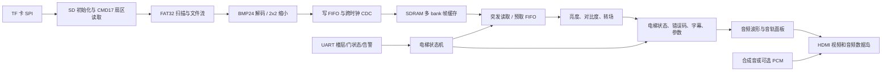

# 基于安路 EG4S20 的电梯轿厢信息屏工程复审与优化计划

审查日期：2026-10-27  
工程：`lab_ex4_tf`  
器件：EG4S20BG256 / HX4S20C 开发平台  
当前 Git HEAD：`1849cf8`  
主工程入口：`src/td_project/lab_ex5_i2s_v1.0.al`  
顶层模块：`src/user_source/hdl_source/top_tf_hdmi_audio.v`

## 1. 审查结论

当前工程已经具备赛题一的主体技术链路：TF 卡资源扫描、FAT32 文件读取、BMP 解码、SDRAM 帧缓存、HDMI 视频、HDMI 音频、字幕、参数 OSD、转场、缩略图、音频波形和电梯告警状态控制。工程的主要问题已经从“功能缺失”转为“时序闭合、首图时间量化、场景功能收敛和实板证据不足”。

建议最终统一包装为：

> **基于国产 FPGA 的电梯轿厢离线宣传、便民与应急信息屏**

它负责在轿厢内显示安全须知、楼层和门状态、物业提示、应急引导及提示音。电梯楼层、方向、门状态和告警数据由 UART 或本地开关模拟输入。系统不接管电梯安全回路，不向电梯控制器发送运行命令，也不宣称具备商用电梯安全认证。

当前最需要优先解决的是：

1. 当前重新运行的 TD 物理构建存在保持时间违例，不能把历史 bitstream 的时序结果当成当前工程已经闭合。
2. 首图提前显示逻辑已经存在，但上电到首图仍缺少分段时间戳和实板统计。
3. 电梯场景功能已经较完整，应冻结功能规模，优先保证告警响应、故障显示和长期运行稳定性。
4. 低功耗应先采用时钟使能、操作数隔离、静音和 SD 空闲策略，并用电流实测支撑结论；当前不能直接宣称已经支持 SDRAM 自刷新或 PLL 深度待机。

## 2. 赛题要求与当前工程的对应关系

官方赛题一要求使用安路 EG4S 系列 FPGA，自主完成音视频控制和数据处理，体现并行处理、实时控制、低延迟显示、音画同步和多源信息融合。基础要求包括显示稳定、基础音频和工程完整性；字幕、转场、缩放、实时参数调节、OSD 和音频可视化属于扩展项。

当前工程对应情况如下：

| 赛题方向 | 当前实现 | 复审结论 |
|---|---|---|
| 本地图像资源扫描 | FAT32 卷扫描、文件目录定位 | 已具备，需补充卡异常和碎片文件测试 |
| BMP 图像解析 | 24 位无压缩 BMP，支持 640×480 和 2 倍源图缩小 | 已具备，PIC4 的 1280×960 路径需重点验证 |
| SDRAM 帧缓存 | 多 bank 图片缓存、写 CDC、读 FIFO、突发预取 | 架构正确，保持时序和复位路径需要优先收敛 |
| HDMI 视频 | 640×480 视频时序和 TMDS 输出 | 已具备，必须以完整布局布线结果和实板为准 |
| HDMI 音频 | 合成音、可选 PCM/WAV 链路、音量和淡入淡出 | 合成音可用，真实 PCM 需要单独启用和验收 |
| 交互控制 | 按键、拨码、UART 字幕和电梯状态协议 | 已具备，建议固定一套演示协议 |
| 音视频联动 | 告警页、字幕、提示音、波形和帧边界提交 | 已具备，应量化告警响应帧数和音画时差 |
| 额外处理器限制 | 当前由 FPGA RTL 完成控制和数据处理 | 符合要求，答辩中要明确无额外处理器 |

素材原创和来源说明已经放在 `media/elevator_photo_pack/README.md` 与 `manifest.json`。正式提交前应继续保留来源、作者、许可证和素材生成记录。

## 3. 当前架构与关键数据路径



首图路径已经采用 `EARLY_DISPLAY=1`，系统在至少一张图片完成校验并写入排空后即可打开显示，后续图片继续后台加载。这个方向应保留。

## 4. 当前工程审查结果

### 4.1 时序是当前第一风险

历史已闭合报告曾出现接近零的保持裕量，例如 HWNS 约 `+0.003 ns`，说明工程本来就缺少足够余量。最近一次 TD 重新构建报告为：

```text
SWNS = +0.280 ns
STNS =  0.000 ns
HWNS = -1.193 ns
HTNS = -3.367 ns
```

这次结果不能作为最终 bitstream 验收结果。当前应先解决保持和 recovery/removal 路径，再进行大规模功能扩展。不能通过扩大 false path 或删除约束来掩盖真实路径问题。

历史报告和当前报告来自不同构建，应在答辩资料中明确区分：

| 证据 | 当前用途 |
|---|---|
| 历史 `best_result` / `build_out` 报告 | 说明某一历史版本的资源和时序情况 |
| 当前 `phy_1/lab_ex5_i2s_v1.0_pr.timing` | 说明最近一次重新构建的失败状态 |
| 新生成 bitstream 的报告 | 只有与源码、约束、工程入口一致时才能作为最终证据 |

### 4.2 像素域组合逻辑过长

`promax_audio_waveform.v` 同时完成面板区域判断、采样索引、插值、辉光、填充、峰值柱和颜色混合。历史最差路径位于文字输出到波形输出之间，约 29 级逻辑，布线和高扇出占比较大。

`promax_text_overlay.v` 还包含字符区域判定、字符地址、字形行选择和十进制显示。多个图层最后串接到 RGB 选择器，使像素域路径变长。

建议把像素链拆为：

1. 坐标和区域判定；
2. 字符/采样数据读取；
3. 颜色混合和输出选择。

三组信号必须同步延迟：`RGB`、`HS`、`VS`、`DE`、`pixel_x` 和 `pixel_y`。每次只改一个模块，并检查图像是否发生一到三像素的偏移。

### 4.3 首图启动仍由 SD/FAT32 决定

首图读取时间主要受以下因素影响：

- SD 初始化中的固定上电等待约 100 ms；
- 旧镜像每簇一个扇区时，PIC1 约 1800 个簇，FAT 查询频繁；
- 每个数据扇区使用 CMD17，存在命令和响应开销；
- BMP 解码、写 FIFO 排空和 SDRAM 仲裁会增加尾部时间。

当前 `tools/prepare_media.py` 已支持默认 8 扇区/簇，并可用 `--sectors-per-cluster` 回退到 1、2、4、16 等格式。使用 8 扇区/簇时，PIC1 的簇数量理论上从约 1801 降至约 226，但实际收益仍需实板测量。

首图必须保持：

- PIC1 在目录和数据区域的最前端；
- 数据连续分配；
- 640×480、24 位、无压缩 BMP；
- 不等待 PIC2～PIC5 全部完成；
- 保留 FAT 校验、BMP 完整性检查和 CDC 排空确认。

### 4.4 资源仍有扩展空间，但不适合继续堆大型算法

历史报告中资源大致为 LUT 81.73%、BRAM9K 23.44%、DSP 58.62%、PLL 1/4。当前 DSP 余量适合少量共享乘法或低资源频带分析，但不适合直接加入大型 FFT、复杂双线性缩放或多套新时钟。

优先用 BRAM 和寄存器替代高速组合计算：字形 ROM、参数缓存、预计算颜色表和状态表都比继续增加像素级除法更合适。

### 4.5 低功耗接口存在明确边界

当前工程适合做以下低功耗优化：

- 音量为 0 时暂停未选音源和无效增益计算；
- SD 读取完成后停止 SD 业务状态机；
- `DE=0` 时停止 RGB 算术输入更新；
- alpha 为 0 或 255、亮度/对比度处于端点时做旁路和操作数隔离；
- 按键、长按、OSD 参数转换使用低速 CE。

当前不能直接宣称：

- SDRAM 已进入自刷新；
- PLL 已支持运行时 standby；
- 关闭 FPGA 内部逻辑就等于关闭 HDMI 或 SDRAM 功耗；
- 仅减少 LUT 就等于整机功耗按比例下降。

`sdram.v` 中 CKE 仍固定为高，PLL standby 也没有形成运行时休眠接口。深度待机必须先确认器件原语、SDRAM 控制器和板级电源结构。

## 5. 电梯场景功能审查

### 5.1 推荐产品叙事

推荐固定为一个主场景：

> **电梯轿厢离线宣传、便民与应急信息屏**

日常状态显示安全乘梯须知、物业服务、楼层索引和社区信息；接收到告警事件时暂停普通轮播，在帧边界切换到紧急页面，叠加告警字幕和提示音；告警解除后恢复原来的图片和轮播状态。

这个叙事与当前素材包、UART 协议、PIC5 优先加载、逻辑备用页、字幕、波形和错误显示完全对应，也符合赛题要求的图像、音频、交互和多源信息融合。

### 5.2 图片和状态分工

| 资源 | 电梯场景用途 | 当前建议 |
|---|---|---|
| PIC1 | 住宅电梯厅或日常宣传 | 作为首图，优先点亮 |
| PIC2 | 安全乘梯须知 | 正常轮播页 |
| PIC3 | 楼层索引、物业服务、联系电话 | 正常轮播页 |
| PIC4 | 社区生活或维保宣传 | 1280×960 源图，验证 2×2 缩小 |
| PIC5 | 紧急提示页 | 告警优先页，不参与普通四格缩略图 |
| 逻辑备用页 | PIC5 尚未加载或读取失败 | 保证告警状态仍可见 |

正式部署前应替换素材中的联系电话占位信息，并再次生成素材清单和哈希。

### 5.3 电梯状态机

现有 `elevator_demo_controller.v` 已形成 `STARTUP`、`NORMAL`、`ALERT`、`RECOVERY`、`FAULT` 五类状态。建议把验收行为固定成：

- `STARTUP`：TF 卡或 SDRAM 未准备好时显示 FPGA 生成的启动页和 `LOAD` 状态；
- `NORMAL`：显示 PIC1～PIC4，允许自动轮播、按键和字幕；
- `ALERT`：暂停轮播，优先显示 PIC5；PIC5 不可用时显示逻辑红色备用页；
- `RECOVERY`：告警清除后等待帧边界和目标 bank 就绪，再恢复原图片；
- `FAULT`：保持 HDMI 时序和上一张完整图或故障页，显示错误码和细分码。

UART 演示协议建议固定为：

```text
ELEV=F05,D=U,DO=C,A=0
ELEV=FB1,D=S,DO=M,A=1
ALERT=ON
ALERT=OFF
ELEV?
```

答辩时明确说明这些数据用于演示状态显示，来源是 UART 或拨码模拟输入。

## 6. 分阶段优化计划

每个阶段单独修改、单独 Git commit、单独综合和布线，避免把时序、首图、显示效果和功耗结论混在同一个版本里。

### 阶段 0：基线审计与版本冻结，1 天

目标是把当前工程变成可比较的基线。

任务：

1. 固定 TD 工程入口、顶层、器件、约束和当前 Git 提交。
2. 保存当前 bitstream SHA256、资源报告、时序报告和构建日志。
3. 记录首图、告警、普通切图、连续运行和故障恢复现状。
4. 确认烧录 bitstream 与当前源码一致。
5. 将 PIC1～PIC5 素材、协议和演示脚本锁定。

验收：

- 能从 Git 恢复同一工程；
- 能明确区分历史已闭合报告和当前构建失败报告；
- 有一份实板基线记录。

### 阶段 1：时序和基础稳定性，2～3 天

目标是先得到可重复的时序闭合版本。

任务顺序：

1. 冻结大型功能，不新增 FFT、复杂缩放和 CMD18。
2. 检查复位异步断言、同步释放和高扇出 recovery 路径。
3. 对 `promax_text_overlay.v` 做字符地址和字形读取寄存化。
4. 对 `promax_audio_waveform.v` 做两级流水：区域/采样计算一级，混色输出一级。
5. 同步 RGB、HS、VS、DE、坐标和错误页路径。
6. 每次修改后单独运行综合、布线和完整 STA。

验收指标：

- HWNS、HTNS 不为负；
- 建立和保持有明确工程余量；
- 640×480 无花屏、无撕裂、无行偏移；
- 普通页、告警页、备用页和缩略图均可显示。

### 阶段 2：电梯核心流程，2 天

目标是让场景功能形成完整闭环。

任务：

1. 验证 UART 楼层、方向、门状态和告警命令。
2. 验证 `ALERT=ON` 下一帧显示 PIC5 或逻辑备用页。
3. 告警期间暂停自动轮播和普通切图。
4. `ALERT=OFF` 后恢复原图片和自动/手动状态。
5. 验证 PIC5 缺失、坏 BMP、拔卡、FAT 错误和 CDC 溢出时的可见故障状态。
6. 验证电梯模式下 SW4 告警功能不会误触发普通媒体模式的测试音逻辑。

验收指标：

- 告警触发到告警页显示不超过 1 个视频帧；
- 告警清除到正常页恢复不超过 2 个视频帧；
- PIC5 不可用时仍有红色备用页；
- 错误码、数码管和 UART 状态一致。

### 阶段 3：首图启动优化，2～3 天

目标是把“上电快速点亮第一张图”变成可量化指标。

任务：

1. 在 50 MHz 系统域记录：`power_ready`、`sd_ready`、`volume_scan_done`、`PIC1_found`、`BMP_header_ok`、`frame_written`、`image_complete`、`first_de`。
2. 用 `prepare_media.py --sectors-per-cluster 8` 生成新 TF 镜像。
3. PIC1 保持 640×480、24 位、连续存放。
4. 先保持 SPI 分频 2，比较新旧镜像的首图时间。
5. 在同一张卡稳定后单独测试 SPI 分频 1；记录 CRC、失败率和输入电流。
6. 只有在指定卡反复冷启动通过后，才考虑将启动等待从 100 ms 降低。

验收指标：

- 冷启动 10 次平均和最大首图时间；
- K1 复位 10 次平均和最大首图时间；
- 拔插 TF 卡 10 次成功率；
- 首图显示时后续图片仍可后台加载；
- 无首图半帧、花屏或音频异常。

### 阶段 4：低功耗与活动率，2～3 天

目标是用实测数据证明低功耗设计。

任务：

1. SD 读取完成后停止 SD 业务状态机。
2. 音量为 0 时暂停未选音源和无效增益计算。
3. 在 `DE=0`、alpha 端点、亮度/对比度端点做操作数隔离。
4. 低速按键、长按、OSD 转换使用共享 CE。
5. 生成代表性 VCD/SAIF，比较逻辑优化前后的翻转活动。
6. 在相同显示器、TF 卡、图片、音量和温度下测量输入功率。

验收指标：

- 启动平均/峰值电流和加载能量；
- 正常轮播功耗；
- 静音功耗；
- 无按键空闲功耗；
- 保持画面或黑屏待机功耗；
- 唤醒时间和重新显示时间。

### 阶段 5：答辩冻结，1～2 天

冻结内容：


1. 一份通过完整 STA 的 bitstream；
2. 一套 PIC1～PIC5 素材和版权说明；
3. 一份 UART 协议表；
4. 一份启动、告警、恢复、功耗和长时间运行证据表；
5. 一套现场演示脚本和故障演示脚本。

## 7. 推荐现场演示流程

1. 冷启动：音量为 0，显示启动状态和首图加载过程。
2. 首图出现：展示首图点亮时间，说明后续图片在后台加载。
3. UART 下发 `ELEV=F05,D=U,DO=C,A=0`，顶部显示楼层、上行和关门状态。
4. 普通轮播：展示安全须知、物业信息、社区宣传和缩略图。
5. 发送 `ALERT=ON`，下一帧切换 PIC5 或逻辑备用页，暂停普通轮播。
6. 显示提示字幕和波形，说明音画事件同步。
7. 发送 `ALERT=OFF`，恢复原图片和自动轮播。
8. 演示缺 PIC5、坏图或拔卡，展示错误码和可见故障页。
9. 最后展示 LUT、BRAM、DSP、时序、首图时间、告警帧数和功耗数据。

## 8. 最终验收指标表

| 类别 | 指标 |
|---|---|
| 启动 | 上电到首图平均值、最大值、失败次数 |
| 告警 | 告警触发到紧急页的帧数 |
| 恢复 | 告警清除到日常页恢复的帧数 |
| 显示 | 640×480 HDMI 连续运行，无花屏、撕裂、丢帧 |
| 音频 | 启动静音、提示音有效、音画事件同步 |
| 交互 | UART、按键、拨码状态一致 |
| 可靠性 | 缺卡、坏 BMP、缺 PIC5、FAT 错误、FIFO 溢出可解释恢复 |
| 资源 | LUT、寄存器、BRAM、DSP、PLL 使用量 |
| 时序 | SWNS、STNS、HWNS、HTNS 和 STA 覆盖率 |
| 功耗 | 加载、播放、静音、空闲、待机平均/峰值电流 |
| 长稳 | 至少 30 分钟连续运行，建议增加 2 小时记录 |
| 素材 | 图片、音频、字体和 Logo 的来源、许可证和哈希 |

## 9. 当前不建议实施的事项

- 不要在保持时序未收敛时加入大型 FFT、复杂缩放或多套新时钟。
- 不要直接把 CMD17 改成 CMD18，除非先完成多块停止、错误恢复和碎片文件测试。
- 不要通过放宽时序约束掩盖 recovery、hold 或 CDC 问题。
- 不要把 640×480 原型包装成完整商用电梯安全系统或户外 LED 接收卡。
- 不要把 UART 模拟的楼层和告警数据描述成真实电梯传感器数据。
- 不要在没有电流实测时给出固定百分比的功耗下降结论。

## 10. 推荐优先顺序

```text
时序闭合与基础稳定
        ↓
电梯告警/恢复流程量化
        ↓
首图时间戳与 8 扇区/簇媒体实测
        ↓
像素 OSD/波形流水线优化
        ↓
静音、CE、操作数隔离和 SD 空闲功耗
        ↓
完整 bitstream、实板证据和答辩冻结
```

这个顺序能同时满足赛题对稳定 HDMI 音视频系统、FPGA 自主处理、低延迟显示和多源信息融合的要求，也能让电梯场景从“图片播放演示”收敛为“日常信息 + 状态提示 + 高优先级应急页面 + 故障可解释”的完整终端方案。
