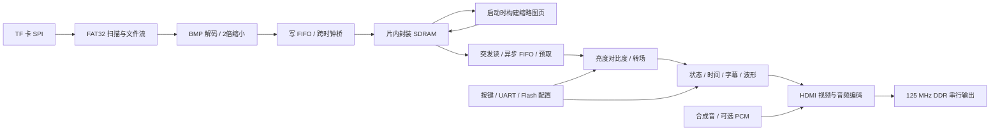

# 当前工程逻辑与低功耗优化方案

分析日期：2026-10-08。范围为 `lab_ex4_tf` 当前有效工程 `src/td_project/lab_ex5_i2s_v1.0.al`，顶层 `top`。同目录外的 `lab_ex5_i2s`、归档源码与旧 `release/` 不作为当前基线。下文记录实施前的方案分析；后续已完成读卡提速、首图提前显示与音轨面板优化，结果见 [快速启动与音轨界面优化](快速启动与音轨界面优化.md)。

## 1. 证据与架构基线

分析时已核对当时的 `Runs/best_result/validation.json`，117 项输入文件的 SHA256 均与修改前文件一致。以下采用 2026-09-28 15:52 构建记录，现已备份至 `tests/results/before_fast_boot/best_result`；新版构建记录在 `Runs/best_result`。旧 `run.log` 存在不同构建的数据，不能混用。

| 指标 | 当前基线 | 含义 |
| --- | --- | --- |
| 工具识别器件 | EG4S20BG256 | 工程文档称 HX4S20C，资源判断以实际工具报告为准 |
| LUT | 14395 / 19600，73.44% | 逻辑与布线已有明显压力 |
| 寄存器 | 7938 / 19600，40.50% | 可用增加少量流水寄存器换取时序 |
| BRAM9K | 15 / 64，23.44% | 可考虑字符 ROM、映射表等存储替代 |
| DSP | 17 / 29，58.62% | 有余量，但不能无限增加乘法器 |
| PLL / 全局时钟 | 1 / 4，4 / 16 | 已使用单 PLL；不能简单删掉反馈输出 |
| 全局 SWNS / HWNS | +0.018 ns / +0.004 ns | 通过当前约束，余量较小 |
| 像素域内部最差建立裕量 | +4.552 ns | 与全局 0.018 ns 的复位 recovery 路径不同 |
| STA 覆盖率 | 99.97% | 仍需检查未覆盖路径及外部接口约束 |

证据：`src/td_project/lab_ex5_i2s_v1.0_Runs/phy_1/td_20260928_155008.log:1294`、`phy_1/final_timing.rpt:28`、`best_result/validation.json`。

时钟合同为系统 50 MHz、SDRAM 40 MHz、移相 SDRAM 40 MHz、像素 25 MHz、串行 125 MHz。视频为 640×480，有效区外总时序 800×525，因此实际刷新率为 59.524 Hz。

当前图片在启动阶段读入 SDRAM，四张原图与一张预合成缩略图页供显示使用。每个像素用一个 32 位 SDRAM 字保存 RGB888；平均显示读取量为 `640×480×4×59.524 ≈ 73.14 MB/s`。应用接口理想吞吐为 `40 MHz×4 B = 160 MB/s`，扣除刷新、行操作、突发间隔后才是实际可用带宽。读 FIFO 默认 512 字、128 字突发，允许最多两个在途突发。

当前 `PCM_START_LBA=0`、`PCM_TOTAL_SECTORS=0`，物理 PCM 播放功能被常量禁用，音频使用合成音。目录存在 `bilinear_8q8.v` 并不代表其在当前硬件通路中运行；实际 1280×960→640×480 使用 2×2 均值缩小。UART 报告已使用十六进制以避免动态十进制除法；SD/Flash 字节引擎空闲时 SCLK 已停止；这些已有优化应保留。

## 2. 已确认的瓶颈

### 2.1 复位释放比最高频时钟更需要优先处理

全局最差路径为 `u_mem_reset/s2 → u_video/u_reader/u_prefetch/slot0[5].sr`，检查类型是 recovery，预算 5 ns，裕量 0.018 ns，最大扇出 269。`media_frame_reader.v:84` 将两个时钟域的复位和 FIFO 重装状态组合为公共复位，`media_frame_reader.v:374` 又用它直接复位像素域预取逻辑。

这不等同于“125 MHz 串行逻辑跑不动”。串行域内部最差建立裕量为 5.791 ns。优化应首先改善各域复位释放及复位扇出，不能靠把相关域整体设为 false path 隐藏问题。历史上恢复原厂 FIFO、提高布局布线强度才得到清晰图像，FIFO 替换和复位修改必须做独立回归。

### 2.2 字幕/OSD 位于深组合路径

像素域内部最差路径从 `u_video/video_x_q[2]` 到 `u_audio/video_rgb_q[19]`，数据路径延迟 35.168 ns，其中布线占约 70%，逻辑 26 级、最大扇出 119。路径经过字幕横坐标、字符选择和字形计算。

`promax_text_overlay.v` 每像素计算 `/12`、`/18`、动态字符切片与字形行选择，参数字符还调用十进制 `/100`、`%100`、`/10`、`%10`。这些常数除法会被综合成逻辑网络，但并不都等价于一次移位。顶层状态、细分错误、时间、字幕和波形层串联，增加最终选择与布线压力。

### 2.3 低速任务采用过多并行/宽位计算

`config_journal.v:38` 的 CRC 函数在组合逻辑中展开 40 次迭代，两个槽位校验与保存计算可复用顺序引擎。`subtitle_uart_controller.v` 使用 40 字节宽寄存器缓存，收到换行后并行解析文本，存在动态切片与多字符比较。

最新综合层级报告中，存储加载层含 6837 cells、配置持久化层 3348 cells、音频桥 2459 cells、字幕串口控制器 1051 cells；这些是综合 cells，不能直接当作 LUT 或功耗百分比。说明仅优化视频乘法不能覆盖主要面积来源。

另有宽计数器：默认 UART 位周期 434，接收计数器却为 32 位；图片像素计数 307200 可用 19 位，但 loader 使用 32 位；默认超时 65535 可用 16 位。应按参数上界定宽，而非把所有实例固定裁成默认宽度。

### 2.4 长时间不变的值仍反复计算

顶层 `top_tf_hdmi_audio.v:389` 的毫秒转秒逻辑完成后立即重启，在周期参数不变时仍不断执行减 1000、计数、重载。视频控制、时间基准等还存在按高速时钟运行的长周期计数器，适合共享 tick 或低频时钟使能。

颜色模块每通道有亮度乘法和对比度乘法，转场另有三通道乘法。alpha=255 虽选择直接输出，仍变化的 RGB 输入可能让被旁路乘法网络产生翻转；输出 mux 本身不能保证内部算术停止。

### 2.5 静态画面仍有持续存储和 HDMI 活动

图片不变时 HDMI 仍需每帧读取与输出。当前系统没有保持全帧的片上 BRAM 容量，不能因为图片静止就停止 SDRAM 帧读取。只关闭 OSD/音频也不代表 HDMI PHY 和时钟停止。

SDRAM 包装 `hdl_source/SD/sdram.v` 将原语 `.cke(1'b1)` 固定为高。`self_refresh_open` 在公开控制逻辑中产生的是周期刷新请求，不是 CKE 低电平的低功耗自刷新。当前 PLL `STDBY_ENABLE="DISABLE"`、`.stdby(1'b0)`，没有运行时休眠接口；顶层也没有 HDMI HPD 输入。

## 3. 优化措施、收益及取舍

下述收益是可推导的局部收益或预期方向；尚无功耗报告、活动率文件或电流实测，不能承诺整机降低某个百分比。难度：低表示局部修改；中表示跨模块接口或握手修改；高表示时钟、存储协议、启动恢复或板级配合。

| 优先级 / 措施 | 具体实现 | 预期收益 | 难度与取舍 |
| --- | --- | --- | --- |
| P0：各域复位同步释放 | 保留原厂 FIFO 必需的公共复位；为像素预取状态提供本域异步断言、同步释放，并用两域 ready/ack 控制重装完成后发读写；适当分摊高扇出复位 | 改善当前 0.018 ns recovery 路径，降低冷启动和帧重装风险 | 中高；增加数拍恢复延迟和同步寄存器；验证帧首像素、旧数据清空、同步时钟可用性 |
| P1：参数变化才重算 | 毫秒转秒启动条件改为复位后首次或 `period_ms` 改变；期间锁存输入，完成后保持；OSD 参数十进制转换也只在更新时运行 | 参数稳定时转换器可停止绝大多数数据翻转；去掉像素组合路径中的重复数字转换 | 低；结果延迟几十到几百拍，对人机操作可忽略；并发更新需 dirty 标志或重启机制 |
| P1：按上界定宽 | UART 默认 32→9 位；307200 像素计数默认 32→19 位；超时用 `$clog2(limit+1)`；替换大范围 integer 临时量 | 缩短加法/比较链，减少不必要寄存器和组合逻辑 | 低中；收益以综合结果为准，工具可能已裁剪部分位；保留溢出检测与参数兼容，文件 LBA/文件大小不盲目缩窄 |
| P1：消隐与旁路操作数隔离 | RGB 算术输入寄存器按 DE 更新；转场仅在有效像素且 alpha 非端点时送入真实算术输入；OSD 字形地址仅在区域内更新 | 消隐占总周期 26.86%，可削减相关像素算术在这部分周期的活动；静态转场减少被旁路乘法翻转 | 中；这是局部活动率收益，非整机节电比例；HS/VS/DE/坐标、音频岛和 TMDS 编码状态继续按协议推进 |
| P1：字幕与 OSD 分段流水 | 坐标/区域判定、字符与字形读取、颜色合成分为 2–3 级；统一延迟 RGB、HS、VS、DE、x/y 和诊断路径；各层输出覆盖标志，按原优先级合成 | 拆分 26 级组合链，改善时序与布线，降低组合毛刺 | 中高；增加 1–3 像素延迟和少量寄存器；必须保持 HDMI 音频岛使用坐标与视频同拍，新增时钟功耗也需计入 |
| P1：用扫描计数与字形 ROM 替换动态计算 | 对 12/18 像素字符周期用 cell/column 计数；每行准备滚动起点余数；将字形转为小 ROM，参数字符先缓存，再按字符边界读取行位图 | 减少常数除法网络、动态宽 mux 与高扇出；利用富余 BRAM | 中；同步 ROM 增加延迟，必须配套流水；不建议只为移位把字符宽度改成 16，因为会改变现有布局 |
| P1：顺序 CRC 和流式 UART 解析 | CRC 用一个 16 位状态引擎，按字节或位推进并复用槽位；UART 逐字节维护命令/文本合法性，回车时提交；保留失败时原文本 | 削减并行 CRC 与多字符解析逻辑；重计算仅在命令/保存时发生 | 中；80 位 CRC 每位一拍在 50 MHz 下为 1.6 µs，远低于 Flash 擦写时间；报文、CRC 字节顺序、双槽掉电恢复必须兼容 |
| P2：颜色映射表 | 按亮度、对比度变化构建 256 项 `8→8` 精确映射表，三通道查同一函数；用复制 ROM/RAM 提供每拍三次读；后台填备用表，帧边界切换 | 将每像素两级颜色乘法/饱和网络替换为查表；保留已有截断和钳位语义 | 中高；单表 2048 bit，三路读需多端口复制，双缓冲也占 BRAM；比较新表与原公式全部 256 输入，确认参数更新延迟 |
| P2：简化音频活动 | 未被选中的合成音/测试音暂停样本生成；切换时清理 valid/FIFO 后恢复；共享采样 tick 前先确认综合是否已经合并重复逻辑；音量增益仅接受新样本时运算 | 降低未选音源及样本间隔内的活动；数据通路有效工作速率仅 48 kHz | 中；需选择继续相位还是重启旋律，避免旧样本和爆音；静音仍发送合法静音样本、ACR 和必要信息包 |
| P2：共享低速计时及 SD 引擎 | 人机长按/去抖用共享 1 ms CE；自动轮播保留毫秒计时与帧边界提交；SD 初始化与读扇区复用一个字节引擎/命令服务 | 减少多套大计数器和串行引擎；业务计数更新由 MHz 降到 kHz | 中；1 ms 精度及取整需定义；初始化 SPI 仍需低速、正常传输可高速；UART 采样与 SPI 边沿不用粗粒度 1 ms tick |
| P2：缩略图黑区跳读 | 当前缩略图有效范围为左上 320×240；在读端对黑区合成常量，仅窗口内读 SDRAM；需按行组织突发和数据标签 | 该模式像素读取量理想可下降 75%，从 73.14 到约 18.29 MB/s | 高；现 reader 按满帧消费与计数，不能只删请求；仅缩略图模式获益，边框/OSD照常合成；行末半突发可能增加命令开销 |
| P2：加载吞吐优化 | 保留低速 SD 初始化；正常读可将 SPI DIV 从 4 调到 2；改善字节间空隙、扇区双缓冲；确有启动需求时再考虑 CMD18 连续读 | 50 MHz 下 SCLK 理论 6.25→12.5 MHz；串行数据时间理想约减半；加快启动并缩短加载模块活跃时间 | 中高；实际受卡延迟、协议开销和 FIFO 背压限制；更高瞬时功耗未必降低总能量，比较启动耗时及能量；不能破坏 SDRAM 连续突发 |
| P2：数码管节能 | 无按键一段时间后降低 LED 占空比或关闭显示；保留当前每轮约 763 Hz 扫描频率并用 PWM 调亮 | 直接降低 LED 平均电流；暂停扫描可降低计数器和引脚活动 | 低；亮度下降，唤醒需按键；单纯降低扫描频率而维持总导通占空比，不能显著减少 LED 电流 |
| P2：配置 Flash 深度掉电 | 完成校验/擦写且 WIP 清零后，按具体 W25Q64 型号支持情况发送 B9；下一次访问前 AB 唤醒并等待规定时间；集中处理 SPI 所有权 | 配置 Flash 长时间不访问时降低其待机电流；现有逻辑已有上电 AB，可扩展日常唤醒 | 中；检查该 Flash 是否参与 FPGA 配置、复位时是否会被重新读取；需验证上电与热复位可恢复，不影响双槽持久化 |
| P3：业务休眠和深度待机 | 定义运行、保持画面、停止显示三种模式；保持画面仅停非必要处理；停止显示才停止帧请求/音频/PHY；SDRAM 低功耗模式与 PLL 待机需厂商支持接口 | 只有停止显示模式才可能显著降低持续视频、存储、时钟与输出功耗 | 高；屏幕失锁/黑屏，唤醒需重新同步/等待 PLL 锁定及首帧预填；当前无 HPD，先用用户命令，不能假设可检测拔线 |
| P3：板级电源控制 | 原理图确认可控负载开关后，再关 TF/显示外设电源；FPGA 与封装 SDRAM 无独立可控电源时保持供电；选择符合器件规范的电源方案 | 外设真正断电可降低静态与待机功耗，适合长时待机 | 高；有硬件成本、上电时序、反向供电与数据丢失问题；不能把 FPGA 内部逻辑当作 ASIC 独立电源域，也不能任意降低核心电压 |

### 3.1 颜色方案的选型

建议先做原算术的定宽、必要流水和操作数隔离，获取改动小的结果，再比较颜色查表。亮度中间结果保留原来的 `bright==255` 旁路与乘积高 8 位，对比度保留算术右移 7 位、偏移 128 和 0–255 钳位。合并成单个数学表达式可能改变中间截断，因此不能未经逐值对比就宣称等价。

若要再把转场合入查表，表还需要随 alpha 每帧更新；需要保证建设时间、两份表切换和音频增益与画面一致。属于第二阶段方案，不建议与首轮复位/OSD 修改一起开展。

RGB565 压缩属于可选产品取舍：若两个像素实际打包进一个 32 位存储字，可将显示存储与传输数据量降低约 50%，但牺牲色彩精度，并改动 loader、缩略图、reader、预取与校验链。仅把像素格式改为 RGB565 却仍一像素一 32 位字，不会获得上述带宽收益。高保真照片模式优先保留 RGB888。

### 3.2 时钟管理与电源管理边界

FPGA 上首选同步 `if (ce)` 更新数据寄存器、BRAM 使能和操作数隔离。CE 降低寄存器及组合活动，但通常不会停止全局时钟树。只有器件确实支持、且工具能够正确约束的专用时钟使能/无毛刺原语，才用于整域关钟；当前 `EG_LOGIC_BUFG` 包装仅有输入输出，不能假设存在现成 CE 端口，更不能用 `clk & enable` 创建普通逻辑门控时钟。

单 PLL 同时服务存储、像素与串行输出；整体 standby 会影响多个域与 lock 状态。`clk0_out` 虽未连接顶层业务端口，但在 PLL 内用作外部反馈，不能当作无用输出关闭。正常显示不能独立随意降低 pixel_clk 或 pixel_clk_5x，否则刷新率、HDMI 链路与音频 ACR 合同都会变化。

若试验 SDRAM 40→32 MHz，接口理想带宽 160→128 MB/s，该域受频率影响的动态功耗分量理想下降 20%；这不是整机降 20%。有效像素期读 FIFO 消耗为 25 Mword/s，32 MHz 仅有 7 Mword/s 瞬时差额，应测刷新与行间隙最坏情况。换频还涉及 10 ns 采样移相、SDRAM 参数、SDC 和模型，应列为后续实测分支而非首选。

低功耗 SDRAM 必须先确认封装原语支持及厂商控制器是否暴露 CKE/进入退出接口，执行预充电、停止业务、低功耗进入/退出时序。当前每帧继续取图时不具备长时间睡眠条件；不能单独停刷新或断时钟后声称保存图像。

## 4. 建议落地顺序与验收

1. **基线记录**：沿用已确认固件，记录功能模式、电压、温度、时钟、时序、LUT/寄存器/BRAM/DSP 及各电源轨电流。建立图像和 HDMI 音频协议对比。
2. **低风险局部优化**：事件触发的转换、按参数定宽、数码管调光、操作数隔离。每项单独构建，避免将多个因素混成一项结果。
3. **结构优化**：复位域释放、OSD 流水/ROM、顺序 CRC、流式 UART。FIFO 原厂版本保留，先完成 reset 与首帧、帧切换、背压回归，再做其余改动。
4. **模式与吞吐优化**：音源按需生成、共享 tick、SPI 吞吐、缩略图跳读、颜色查表，按产品收益选用。
5. **深度待机**：确认外设、电源与厂商低功耗接口后，设计唤醒全过程；未满足接口条件时先落实保持画面的浅休眠。

可复用 `tools/run_tests.py`、`run_vendor_tests.py`、`run_vendor_chain.py`、`test_sdram_refresh.py`。已有测试结果文件记录 14 项通过，但本次未重新运行；已有仿真结论不能替代修改后的验证与板上功耗测量。

| 验收对象 | 核心检查 |
| --- | --- |
| 逻辑等价 | 图像逐像素、色阶端点、BMP 两种方向与两种尺寸、字幕布局、音频包/CRC/BCH 比对 |
| 时序 | 完整布局布线后检查所有实际时钟和 recovery/removal；目标留出明确余量，例如建立 ≥1 ns，作为工程目标而非器件保证；不通过扩大 false path 获取虚假改善 |
| CDC / 复位 | 复位在不同相位发生、首帧、连续切图、帧重装、FIFO 空满、刷新重叠、PLL 重锁 |
| 功耗 | 固定图片/音频/亮度与温度，比较输入功率和可测分轨；记录运行、浅休眠、黑屏待机、加载、唤醒平均/峰值与能量 |
| 活动率 | 采用真实 640×480 时序、代表性图片、音频和空闲输入生成 VCD/SAIF；工具支持时计入后布局布线电容与毛刺，避免仅看 RTL 翻转推断整机功耗 |
| 吞吐 | SD 加载耗时与能量、最小 FIFO 水位、在途突发、underflow、预取断流；增加反压、碎片文件与卡延迟场景 |
| 待机 | 无未完成 Flash 写入、唤醒按键/UART可用、重启配置 Flash 可读取、SD卡重初始化、显示重新锁定 |

用 `P_dynamic ≈ α C V² f` 理解收益：逻辑简化降低活动电容，CE/隔离降低活动率，降频降低频率分量，真实外设断电或芯片低功耗模式才能进一步降低待机部分。少用几个 LUT 不自动等于整机显著省电，最终选型依据应是相同功能和显示条件下的时序、资源与实测功耗。

## 5. 关键源码定位

- `src/user_source/hdl_source/top_tf_hdmi_audio.v:25`：PLL 与各域复位；`:259`：视频流水参数；`:288`：多层叠加；`:338`：可选 PCM；`:389`：重复周期转换；`:399`：常开数码管。
- `src/user_source/rtl/media_frame_reader.v:84`：公共复位；`:119`：突发预留；`:374`：预取复位连接。
- `src/user_source/rtl/promax_text_overlay.v:28`：12/18 字符宽度；`:90`、`:128`：十进制转换；`:269`：像素组合路径。
- `src/user_source/rtl/brightness_contrast_adjust.v:13`：每通道算术；`media_video_pipeline.v:257`：alpha 乘法与旁路。
- `src/user_source/rtl/media_hdmi_audio_bridge.v:76`：采样节拍；`:117`：音源排空；`:120`：增益和背压。
- `src/user_source/rtl/config_journal.v:38`：40 位组合 CRC；`subtitle_uart_controller.v:45`：宽命令缓存。
- `src/user_source/rtl/thumbnail_cache_builder.v:20`：缩略图行缓存与预合成；`media_frame_loader.v:179`：加载地址计算。
- `src/user_source/hdl_source/SD/sdram.v:119`：CKE 固定高；`include/sdr_init_ref.enc.v:129`：周期刷新请求。
- `src/user_source/rtl/sys_pll_promax_40.v:43`：PLL 功能参数；`src/user_source/constraints_source/timing.sdc`：当前时钟、相位与 CDC 例外。
