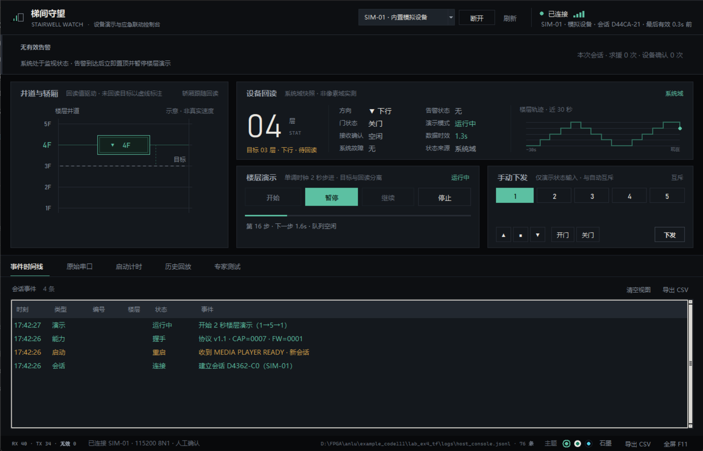
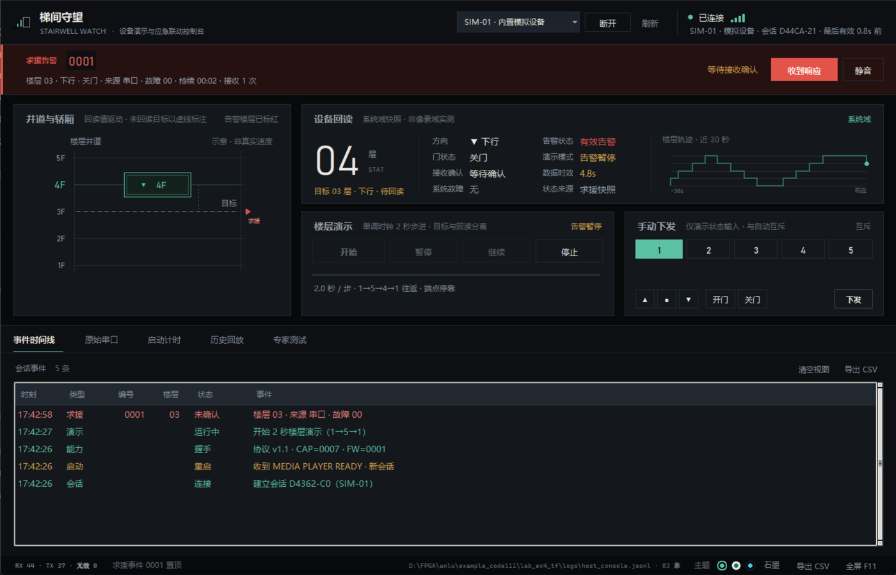
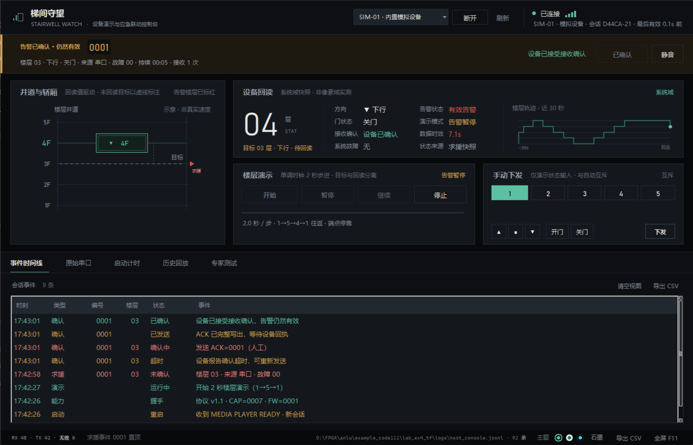
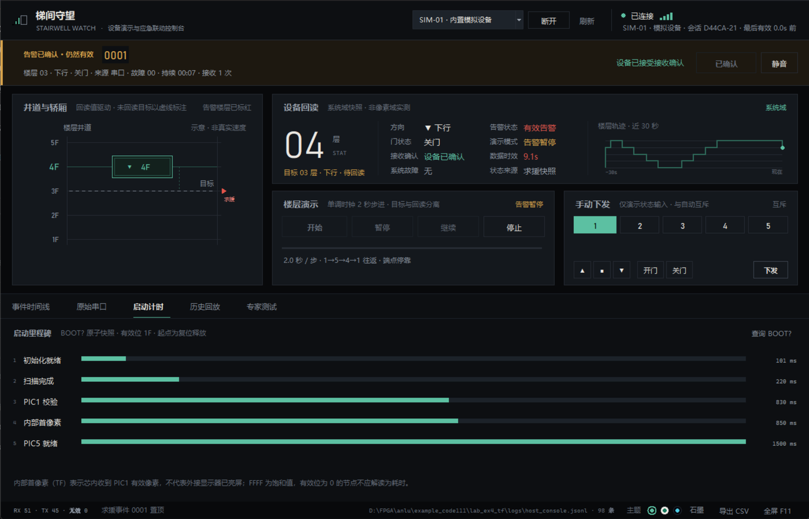
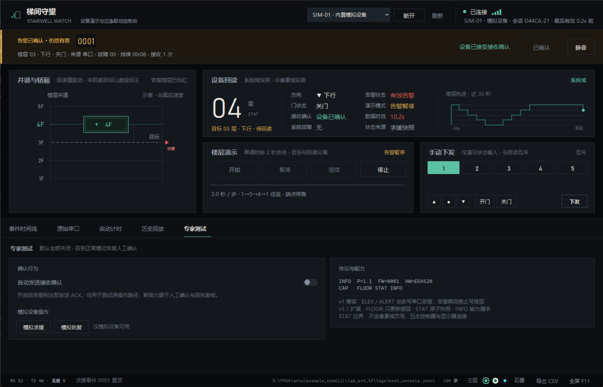
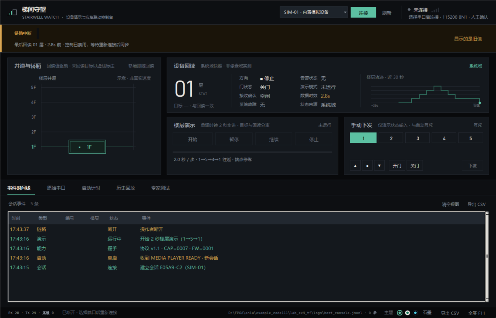
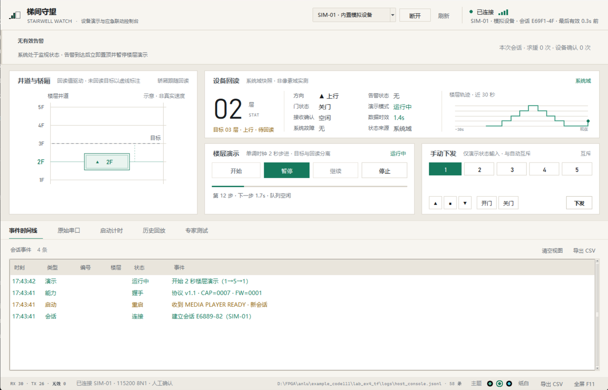
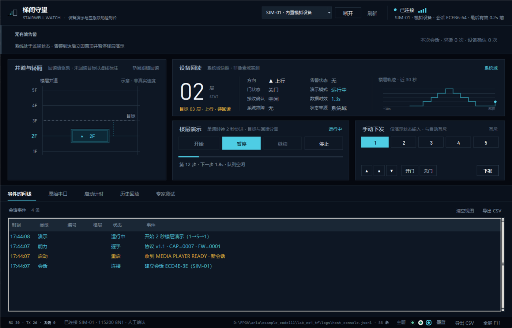

# 梯间守望上位机界面设计（已实现）

> 2026-10-29 更新：按用户新要求改为暖白/中性深灰两套主题、圆角卡片和原生 DPI 绘制。本文原有方角、三套主题、尺寸及截图作为历史设计记录保留，当前实现与验收边界以[高清圆角主题更新记录](../../../../doc/修复验证/host_review_20261028/高清圆角主题更新_20261029.md)为准。

## 文档定位

- 类型：界面设计与实现说明，对应开发计划的 5.1-B「模块划分」与 5.1-C「界面布局」。
- 来源：`梯间守望上位机开发计划_20261028.md`（主文档）、`../../需求/进行中/梯间守望上位机需求_20261028.md`、`梯间守望上位机任务_20261028.md`。
- 实现状态：界面层与上位机核心已落地，用内置模拟设备跑通「连接 → 演示 → 告警 → 确认 → 恢复」闭环；真实串口、固件扩展（INFO/FLOOR/STAT）与实板验收尚未进行。
- 代码入口：`tools/stairwell_watch.py`，包目录 `tools/host_app/`。
- 截图目录：`梯间守望上位机界面/`（由模拟设备驱动真实代码路径截取，非设计稿）。
- 最后更新：2026-10-28。

## 一、设计取向

界面服务的场景是「一个人盯着看，出事时一眼能判断」。因此三条硬约束决定了视觉：

1. **颜色只在有语义时出现。** 底色为石墨黑（#08090B～#111418），常态几乎无彩色；青瓷（#5CC0A2）只表示「在线、回读有效、正在运行」，朱砂（#E2544A）只表示「求援」，琥珀（#D8A24A）只表示「未确认、超时、链路异常」。没有装饰性颜色，所以红色一出现就没有歧义。
2. **回读值与目标值物理分离。** 主卡只显示设备回报的楼层，目标另起一行、井道里用虚线标注。串口写成功不等于画面已更新，界面不能在这一点上撒谎。
3. **结构不随状态跳动。** 告警带常驻顶部（无告警时显示监视态与会话统计），告警到达时只换内容和配色，不改变布局高度，避免操作者正在点按钮时界面位移。

## 二、整体结构

窗口基准 1400×900（最小 1200×780），五段纵向分区，自上而下按「身份 → 告警 → 现状 → 证据 → 系统」排列：

```text
┌───────────────────────────────────────────────────────────────────────────┐
│ ① 顶栏  品牌 / 端口选择 / 连接·刷新 / 连接状态·会话·数据时效              │ 68
├───────────────────────────────────────────────────────────────────────────┤
│ ② 置顶告警带  无告警：监视态 + 本次会话统计                                │ 78
│              有告警：事件编号 + 楼层/方向/门/来源/故障/持续/重发 + [收到响应]│
├──────────────────────────────┬────────────────────────────────────────────┤
│ ③ 井道与轿厢 5F…1F           │ ④ 设备回读：大号楼层 + 8 项键值 + 30s 轨迹   │
│   轿厢缓动跟随回读值          ├──────────────────┬─────────────────────────┤
│   未回读目标用虚线            │ 楼层演示 4 键 + 进度 │ 手动下发 楼层/方向/门   │ 360
├──────────────────────────────┴──────────────────┴─────────────────────────┤
│ ⑤ 页签  事件时间线 | 原始串口 | 启动计时 | 历史回放 | 专家测试              │ 44+ |
├───────────────────────────────────────────────────────────────────────────┤
│ 状态栏  RX/TX/无效 · 最后提示 · 日志路径与条数 · 导出 CSV · 全屏            │ 30
└───────────────────────────────────────────────────────────────────────────┘
```

主区高度按设计固定：回读卡 156、控制行 164；底部两卡按 5:4 分配（演示宽于手动）。

### ② 置顶告警带（固定，不随页签滚动）

- 左起 3px 语义色竖条 + 状态图标 + 标题 + 事件编号（Bahnschrift 20px）+ 一行元信息。
- 元信息固定顺序：楼层 · 方向 · 门 · 来源 · 故障 · 持续 · 接收次数，与协议字段同序，便于对照原始报文。
- 右侧为确认语义文字（等待接收确认 / 确认已发出 / 设备已接受 / 确认超时）与 `收到响应`、`静音`。
- 三态配色：未确认（朱砂底、4px 朱砂竖条低频呼吸）、已确认仍有效（琥珀竖条与文字，按钮转「已确认」并禁用）、已解除（回到监视态，元信息改为「最近事件 + 解除原因 + 演示等待人工继续」）。
- 无告警但链路中断时，整条切换为琥珀「链路中断」态，写出最后回读楼层与时效，提示「显示的是旧值」；有效告警优先于链路提示。
- 无有效事件、断链、回放、落盘失败时 `收到响应` 一律禁用——按钮能不能点本身就是状态说明。

### ③ 井道与轿厢

- 只画 1～5 层，楼层标签、上下导轨、每层水平线；当前层标签与水平线转为青瓷并加重。
- 轿厢是双层描边的方框，内含方向符号与当前楼层；位置用三次缓动跟随回读值，不表现真实速度。
- 目标层与回读不同层时画虚线，并在轿厢右侧延伸一条虚线指示运行段。
- 求援楼层在该行画朱砂标记与「求援」小字；无数据时整块显示「等待设备回读 / 不默认设备在 1 层」。

### ④ 设备回读

- 左侧：大字楼层（Bahnschrift Light 74px）+ 单位 + 数据来源（STAT / ELEV?）+ 目标行。未知时为 `--` 且整体转灰，不显示默认楼层。
- 中部：4×2 键值阵列——方向、门状态、接收确认、系统故障、告警状态、演示模式、数据时效、状态来源。时效按 2.4s / 6s 两档转琥珀与朱砂。
- 右侧：30 秒楼层轨迹（阶梯线 + 当前位置点），把「刚才去了哪几层」变成可核对的形状。

### 楼层演示 / 手动下发

- 演示卡：开始 / 暂停 / 继续 / 停止四键等宽铺满，按状态切换唯一主按钮（未运行→开始，运行中→暂停，暂停中→继续）；下方 2px 进度条表示距下一步的时间，底行显示步号、下一步倒计时、调度队列是否在途。
- 手动卡：1～5 层选择、方向（▲■▼）、门（开门/关门）、下发。标题注明「仅演示状态输入 · 与自动互斥」，与自动演示互斥，且同样经过调度器。

### ⑤ 页签

| 页签 | 内容 | 设计要点 |
|---|---|---|
| 事件时间线 | 时刻 / 类型 / 编号 / 楼层 / 状态 / 事件 | 只记录有判断价值的事件；自动演示的逐层回执不进时间线，避免淹没求援与确认 |
| 原始串口 | 带时刻的 RX/TX 完整行 | `«` 收 `»` 发，发送行用青瓷，非法行转朱砂；自动滚动可关 |
| 启动计时 | 五个 BOOT 节点横条 + 毫秒值 | 未发生节点不画条；饱和 FFFF 转琥珀；下方明确「内部首像素 ≠ 显示器亮屏」 |
| 历史回放 | 载入 JSONL、原文列表 | 载入后全局禁用发送，横幅声明「不计为实板验收」 |
| 专家测试 | 自动确认开关、模拟求援/恢复、协议与能力 | 默认全关；自动确认用朱砂开关区分危险操作 |

### 界面速览

| 运行看板（2 秒演示中） | 求援告警（置顶 + 演示暂停） |
|---|---|
|  |  |
| **告警已确认（仍然有效）** | **启动计时** |
|  |  |
| **专家测试** | **链路中断（显示旧值、控制禁用）** |
|  |  |

同一界面在三套主题下的表现（布局不变，只换令牌）：

| 纸白（浅色） | 墨蓝（高对比） |
|---|---|
|  |  |

## 三、交互设计

### 主链一：连接与同步

选择端口（默认推荐 COM18，列表末尾固定提供 `SIM-01 · 内置模拟设备`）→ 连接 → 新会话、默认人工确认 → 依次 `RESCUE?`、`ELEV?`、`INFO?` → 顶栏显示会话号与「最后有效 N.Ns 前」，信号格随时效衰减。连接期间 `连接` 变 `断开`，端口选择保持只读。

### 主链二：2 秒楼层演示

1. `开始` 要求已连接、无有效告警、已回读 1～5 层，否则以状态栏提示拒绝原因。
2. 目标序列 1S→2U→3U→4U→5S→4D→3D→2D→1S 循环；每步写出后从写出时刻重新计时，事务忙时只前进一步，不补发追赶。
3. `暂停` 在状态可靠且无告警时发同层停止方向；`停止` 不重置设备楼层；恢复只从已回读层继续，楼层未知则要求重新开始。
4. 告警、链路超时、启动标志都会把演示置为暂停态，解除后不自动恢复，必须人工点 `继续`。

### 主链三：告警确认闭环

求援到达 → 告警带置顶、演示暂停、按钮点亮 → 点击 `收到响应` → 状态转「确认发送中」→ ACK 完整写出后转「确认已发出，待设备回执」并立即补一次 `RESCUE?` → 设备回 `C=ACKED` 后转「设备已接受接收确认」，告警带保持醒目（ACK 不等于解除）→ 恢复报文或查询显示 A=0 后转已解除，历史保留。

时间线上依次留下：求援（未确认）→ 重发（若有，累计次数）→ 确认发送中 → 确认已发出 → 设备已接受 → 恢复已解除。

### 键盘与快捷操作

`Space` 暂停/继续、`F11` 全屏、`Esc` 退出全屏、`Ctrl+E` 导出 CSV。导出与回放读取都在后台完成，主线程不阻塞。

## 四、视觉系统

下表为默认「石墨」主题的取值；另两套主题的同名令牌见第七节。

| 维度 | 取值 | 理由 |
|---|---|---|
| 底色 | #08090B / #0D0F12 / #14181D / #1D232A | 四层表面，靠明度差分层次，不用阴影 |
| 分隔 | #1C2229 / #262B33 1px | 发丝线代替卡片投影，保持平面感 |
| 文字 | #EBE8E2 / #9AA2AC / #868F9B / #636B77 | 主文字 + 三级灰；两级次级文字对比度 5.4:1 / 3.3:1 |
| 语义色 | 青瓷 #5CC0A2、朱砂 #E2544A、琥珀 #D8A24A | 一色一义，禁止复用 |
| 数字 | Bahnschrift（DIN 系） | 仪表读数感，与中文黑体形成对比 |
| 中文 | Microsoft YaHei UI | 小字号下清晰度稳定 |
| 报文 | Cascadia Mono | 等宽对齐，便于逐字比对 |
| 字号 | 12 / 13 / 14 / 15（bold）/ 64 | 说明 / 标签 / 正文 / 卡片标题 / 主数字，四档可辨 |
| 几何 | 方角 + 1px 线 + 16px 卡片内边距 + 20px 外边距 | 工业仪表语言，避免圆角卡通感 |
| 对齐 | 页面线 20、内容线 37 | 全屏只有两条左起点：页边与卡片内容 |
| 按钮 | 24 / 30 / 36 三档 | 工具条 / 标准 / 主操作，靠高度与填充色双编码 |
| 动效 | 轿厢缓动 16ms、告警竖条 820ms 呼吸、进度条 140ms | 只做「有变化」的提示，不做装饰动画 |

## 五、与规划文档的对应

| 计划条目 | 界面落点 | 状态 |
|---|---|---|
| P0 连接管理（端口、描述、COM18 优先、115200 8N1） | 顶栏端口下拉 + 连接/断开 + 状态灯与信号格 | 已实现 |
| P0 状态可视化（楼层/方向/门/告警/通信/故障/时效） | ④ 设备回读 8 项键值 + 大字楼层 + 时效着色 | 已实现 |
| P0 2 秒演示（开始/暂停/继续/停止，目标与回读分离） | 楼层演示卡 + 井道虚线 + 目标行 + 进度条 | 已实现 |
| P0 人工确认（置顶、暂停、收到响应、默认不自动 ACK） | ② 告警带 + 确认语义文字 + 时间线 | 已实现 |
| P0 诊断与记录（RX/TX、解析、时间线、导出） | 原始串口页、事件时间线页、状态栏导出、JSONL | 已实现 |
| P1 手动演示（楼层/方向/门、告警触发与解除） | 手动下发卡、专家页模拟求援/恢复 | 已实现 |
| P1 启动看板（五节点、有效位、饱和、未知） | 启动计时页 | 已实现 |
| P1 演示辅助（全屏、静音、历史、回放、专家页） | F11、静音、历史回放页、专家测试页 | 已实现（回放为只读简化版） |
| P1 协议扩展 v1.1（INFO/FLOOR/STAT/COMM） | 能力握手显示于专家页；无能力时自动回退 v1 | 上位机侧已实现，固件未实现 |
| P2 打包 EXE | 未做 | 未开始 |

配色与置顶规则对应计划 5.1-C 的四条约束：告警不随页签滚走、A=1 未确认用红底与文字双编码、故障与求援分层（红 > 橙 > 灰）、手动页明确标注「仅演示状态输入」。

## 六、实现说明

### 技术栈选择

沿用计划的 Tkinter/ttk + pyserial，不引入 Web/Electron。为了让 ttk 达到可交付的观感，界面采用「ttk 只做 Treeview/Combobox，其余全部 Canvas 自绘」的策略：按钮、页签、开关、井道、轨迹、信号格都是自绘控件，配色与字号集中在 `theme.py`，避免系统主题干扰。

### 模块边界（与计划 5.1-B 一致）

| 文件 | 职责 |
|---|---|
| `theme.py` | 三套主题的调色板、令牌写回、按钮配色、标题栏深浅 |
| `config.py` | 本机偏好（主题）读写，损坏时回退默认 |
| `widgets.py` | 自绘控件：按钮、页签、井道、轨迹、开关、时效条、信号格 |
| `protocol.py` | v1 与 v1.1 报文编解码、字段校验、命令构造、长度上限 |
| `state.py` | 字段级状态仓库（值 + 来源 + 时刻 + 有效性） |
| `alarm.py` | 告警生命周期：新事件 / 重发计数 / 内容冲突 / 确认 / 恢复 |
| `demo.py` | 2 秒演示状态机与往返序列 |
| `scheduler.py` | 优先级队列：ACK 插队、单普通事务、超时、轮询合并 |
| `journal.py` | JSONL 追加写（fsync）、CSV 导出、回放读取 |
| `transport.py` | 串口与内置模拟设备，同一接口，工作线程独占 |
| `core.py` | 工作线程：解析 → 状态 → 告警 → 日志 → 调度 → 5Hz 快照 |
| `ui.py` | 五区布局、事件泵、渲染与禁用规则、主题切换与控件树重建 |

### 运行

双击工程根目录的 `start_console.cmd`（推荐），或命令行：

```bat
start_console.cmd            :: 选带 tkinter 的解释器，用 pythonw 起窗口，不留黑框
start_console.cmd --check    :: 只打印解释器与 tkinter 探测结果，不开窗口
```

启动器逻辑在 `tools/launch_console.py`：按 `D:/Anaconda` → `D:/Python/3.13.4` → PATH 的顺序找可用解释器，
先做一次模块导入自检（失败时把 traceback 留在控制台并暂停），再用 `pythonw.exe` 以
`DETACHED_PROCESS` 起窗口。直接双击 `.py` 会用系统关联的解释器，可能缺少 tkinter，因此不作为入口。

- 依赖：Python 标准库 Tkinter；连实板需 `pyserial`（`tools/requirements-rescue.txt`）。
- 未接硬件时选择 `SIM-01 · 内置模拟设备` 即可演示完整闭环，界面会标注「模拟设备」。
- 日志：`logs/host_console.jsonl`，导出 CSV 走 `journal.export_csv`。
- 偏好：`config/host_console.json`（当前仅保存主题），删除后回到默认石墨。

### 测试

```bat
D:/Anaconda/python.exe -m unittest tests.test_host_app
```

21 项：协议编解码与非法字段、状态来源与时效、告警生命周期（重发/冲突/确认/恢复/落盘失败）、演示步进与不补发、调度优先级与超时合并、一次模拟设备端到端闭环。与既有 `tests/test_rescue_receiver.py` 合计 29 项通过。

## 七、主题系统

### 三套主题

| 主题 | 定位 | 底色 | 强调色 | 求援色 |
|---|---|---|---|---|
| 石墨 graphite | 默认，暗环境长时值守 | #08090B / #14181D | 青瓷 #5CC0A2 | 朱砂 #E2544A |
| 纸白 paper | 明亮房间、投屏、打印截图 | #EDEAE3 / #FFFFFF | 深青 #16795D | 砖红 #BE3A2C |
| 墨蓝 ink | 投影与远距离观看，冷色高对比 | #05080F / #0E1724 | 亮青 #4ECDE4 | 亮朱 #FF6157 |

三套共用同一组语义位置（表面 4 层、文字 4 级、语义 3 色、构件若干），只换色值，
所以任何界面改动只需在 `Palette` 里加字段，三套主题同时生效。

### 实现方式

- `theme.py` 定义 `Palette` 数据类与 `THEMES`，`apply(key)` 把当前主题的字段写回模块级变量；
  因此 `theme.PANEL` 这类引用在切换后自动指向新值，绘制型控件（井道、轨迹、按钮）重绘即变色。
- Tk 没有样式表，已创建的原生控件不会自己变色。切换时 `Console._rebuild()` 销毁并重建控件树，
  顺序为 重建样式 → 重建五个分区 → 回到原页签 → 从缓冲还原时间线与原文 → 重绘快照。
- 时间线（最近 400 条）与原文（最近 600 行）保存在内存缓冲里，重建后原样恢复，
  不会因为换主题丢掉会话记录；连接状态、告警、演示进度来自快照，天然连续。
- 偏好写入 `config/host_console.json`，下次启动按上次主题打开；文件损坏或缺失时回退石墨。
- Windows 标题栏通过 DWM 的 `DWMWA_USE_IMMERSIVE_DARK_MODE` 跟随深浅，纸白主题下自动转浅色标题栏。

### 入口

- 状态栏右侧「主题 ●●● 石墨」：三枚色片分别是石墨／纸白／墨蓝，点击即刻切换，右侧文字显示当前主题名。
- 快捷键 `Ctrl+T` 循环切换。
- 切换后状态栏给出提示：`主题已切换：纸白 · 浅色，适合投屏、打印与明亮房间`。

### 主题相关的设计约束

1. 语义色不得跨主题复用含义：青瓷/亮青始终是「在线、有效、运行」，朱砂/亮朱始终是「求援」，琥珀始终是「未确认、链路异常」。
2. 浅色主题下所有正文对比度不低于 4.5:1，说明性小字（TEXT_4）不低于 3:1，且只用于非关键提示。
3. 按钮前景色随主题切换（深色主题用近黑字压在青瓷上，浅色主题用白字），不写死。
4. 告警带在浅色下用淡朱底色（#FBEDE9）而不是纯红，避免整屏发烫；靠左侧 3px 竖条与文字保持强度。

## 八、已知边界

- 固件尚未实现 `INFO?`／`FLOOR=`／`STAT?`：界面在旧固件下自动回退 v1，楼层写入改走 `ELEV=...A=0`，存在有效告警时拒绝写入。
- 真实串口、COM18 实板回读、HDMI 画面与告警闭环均未验证；`STAT` 不代表像素域页号或显示器连接状态，界面按「系统域」标注。
- 静音仅切换按钮文案与提示语，未接入实际提示音（计划中的声音提示属 P1 细项）。
- 历史回放为只读简化版：载入 JSONL 后展示原文并禁用全部发送，不重建当时的状态机。
- 自动确认延迟固定为 0 秒，专家页只提供开关，未提供延迟输入。

## 九、自查清单

- [x] 告警在所有页签可见（告警带位于页签容器之外）。
- [x] 目标与回读可分辨（大字只显示回读，目标单独一行 + 井道虚线）。
- [x] 断链、回放、无有效事件时控制按钮禁用。
- [x] 未知楼层显示 `--`，不默认 1 层。
- [x] 未映射故障码显示原码 + 「未映射」，不编造原因。
- [x] 界面无阻塞 I/O，串口与日志在独立线程。
- [x] 三套主题均无对比度不足或语义色错位；切换后会话记录不丢。
- [x] 主题选择可持久化，冷启动按上次主题打开。
- [x] 正文对比度 ≥4.5:1、说明文字 ≥3.3:1（石墨/纸白实测）。
- [x] 全屏左起点只有 20 与 37 两条；主区高度固定 156/164，回读卡内部无位移。
- [x] 按钮收敛为 24/30/36 三档；键盘焦点可见；命令被拒与断链各有明确反馈。
- [ ] 实板连续 30 次步进、告警打断、确认与恢复（待固件与接线）。
